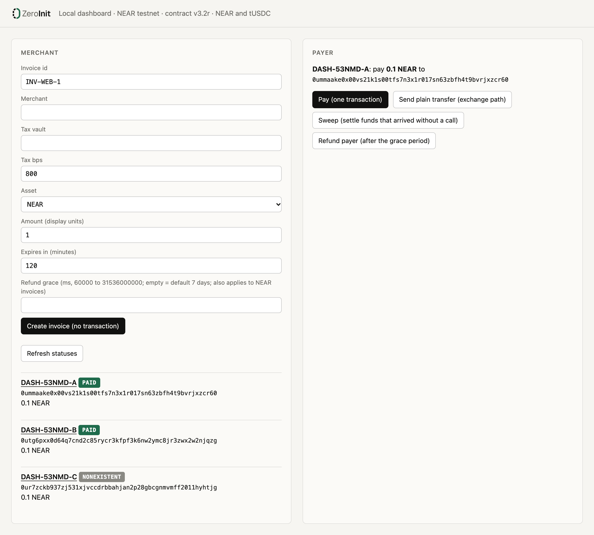

<div align="center">

<picture>
  <source media="(prefers-color-scheme: dark)" srcset="docs/img/logo-dark.png">
  
</picture>

### Invoice addresses that cost nothing until they are paid.

Every invoice gets its own NEAR address, and issuing it needs no transaction.<br>
**[zeroinit.vercel.app](https://zeroinit.vercel.app)** · NEAR **testnet only** · mock token only · MIT

[](https://zeroinit.vercel.app)
[](docs/LIMITS.md)
[](https://github.com/erhantrk/zeroinit/actions/workflows/tests.yml)
[](LICENSE)

[Try it](#try-it-in-2-minutes) · [Claims](#claims-and-how-to-check-them) · [How it works](docs/HOW-IT-WORKS.md) · [Verify](docs/VERIFY.md) · [Limits](docs/LIMITS.md) · [AI use](AI_USE.md)

</div>

---

ZeroInit gives every invoice its own NEAR address, computed from the invoice terms, so issuing an invoice sends nothing to the chain.
The payer's one transaction creates the account, pays the merchant and sets the tax aside (92/8 in the demo); nobody holds a key to that account.

**Why it is new.** Designs that give each item (an invoice, an NFT, a job) its own NEAR account create that account first: one transaction and one storage deposit per item, paid before anyone has paid anything.
ZeroInit derives the address from the terms with NEAR's deterministic account ids (protocol 88), so **issuing costs 0 transactions**; the account comes into existence only when someone pays.

- **Live site:** <https://zeroinit.vercel.app>
- **The one-transaction payment** on testnet: [`GwnQFSjp…`](https://testnet.nearblocks.io/txns/GwnQFSjpCqcPZeSHiTmiu6t5ZMkhM6NQ8vh4NjDzDpWE) (state init + `pay`, 0.92 to the merchant, 0.08 to the tax vault)
- **For AI agents:** an [MCP server](mcp/README.md) with `issue_invoice`, `invoice_status` and `verify_invoice` (read-only, never signs)

Tracks: **Open Innovation** (primary) · **Real-World Money**. Testnet only, mock token only, not audited.


*The local dashboard (`npm run zi -- serve`), Chrome, 2026-11-12 UTC, contract v3.2r. The first invoice was paid in one transaction, the second by a plain transfer and a sweep; the third was issued and never paid, so its account does not exist.*

## Try it in 2 minutes

No keys and no `.env` needed. Node 22; `npm ci` needs the npm registry once, everything after that is offline except the last line.

```bash
npm ci --include=dev
npm test                                             # 242 tests, all pass
npm run zi -- replay fixtures/v32r/demo-run.json     # a recorded live testnet run, replayed offline: every line PASS, exit 0
bash scripts/judge-offline.sh                        # the whole offline check; last line: JUDGE-OFFLINE: ALL PASS
npm run zi -- verify INV-1111-V32R-A                 # one read-only live check over testnet RPC: every line PASS, ends PASS no-access-keys / INFO status=PAID
```

The replay prints, among 62 `PASS` lines, `PASS pay-tx-success INV-1111-V32R-A GwnQFSjp… []`, `PASS split-merchant INV-1111-V32R-A 0.92` and `PASS split-vault INV-1111-V32R-A 0.08`.
Every step, with its full expected output, is in [docs/VERIFY.md](docs/VERIFY.md).

## Headline numbers

| | |
|---|---|
| **0** | transactions to issue an invoice |
| **1** | transaction to create the invoice account, pay and split the money |
| **0** | access keys on an invoice account (`zi verify` prints `PASS no-access-keys`) |
| **0.0075612 NEAR** | measured cost of that one transaction to the payer (gas plus NEAR's 0.007 NEAR account-creation charge) |
| **242 + 94** | offline JavaScript tests (`npm test`) + Rust unit tests on the contract (`npm run contract:test`) |
| **1** | reproducible build: the deployed code `BQLSk5ca…` is what `cargo near build reproducible-wasm` produces at commit `4116e69` ([docs/REPRODUCE.md](docs/REPRODUCE.md)) |

## What NEAR does here

- **Deterministic account ids (protocol 88, NEP-655).** An account id can be the SHA3-256 hash of its future code and state, so the invoice address is printed before the account exists. The invoice terms are inside the hashed state, so they cannot change after issuing.
- **One transaction does everything.** `[UniversalStateInit, FunctionCall pay]` creates the account, runs the contract and splits the payment.
- **Plain transfers work too.** A plain NEAR transfer from any wallet or exchange waits in the "uninitialized" account, which only the matching state init can unlock; then anyone calls `sweep`.
- **Global contract by hash.** The invoice code is published once as a global contract; each invoice only references its hash, and nobody can change what that hash runs.

Details, diagrams and every contract rule: [docs/HOW-IT-WORKS.md](docs/HOW-IT-WORKS.md).

## Claims and how to check them

| Claim | Command | Expected |
|---|---|---|
| Issuing an invoice sends no transaction | `npm run zi -- invoice new --id TEST-1 --merchant example-zi-merchant.testnet --tax-vault example-zi-taxvault.testnet --tax-bps 800 --amount 0.1 --expires-in 2h --offline` | `INVOICE` / `ACCOUNT 0u…` / `PAY` / `FILE` lines, no RPC call |
| One transaction creates the account, pays and splits (NEAR) | `npm run zi -- replay fixtures/v32r/demo-run.json` | `PASS pay-tx-success INV-1111-V32R-A GwnQFSjp… []`, `PASS split-merchant … 0.92`, `PASS split-vault … 0.08` |
| A plain transfer from a wallet or exchange is safe before the account exists | same replay | `PASS transfer-path-uninitialized INV-1111-V32R-B 1`, `PASS sweep-tx-result INV-1111-V32R-B DKFQDCKQ… result=PAID` |
| A token invoice (tUSDC, a testnet mock) is paid by a plain `ft_transfer` and swept by anyone | `npm run zi -- replay fixtures/v32r/token-demo-run.json` | `PASS register-tx-success TOK-1111-V32R-A …`, `PASS ft-parked-balance TOK-1111-V32R-A 1`, `PASS ft-split-merchant … 0.92`, `PASS ft-split-vault … 0.08` |
| Nobody holds a key to an invoice account | `npm run zi -- verify INV-1111-V32R-A` (read-only RPC) | `PASS no-access-keys` |
| The deployed code is the committed wasm, rebuilt from this source | `shasum -a 256 contract/res/v3.2r/zeroinit_invoice.wasm`, then the `verify` above | `9a8f368d…5b92` (base58 `BQLSk5ca…zCFry`); `PASS code-hash-onchain BQLSk5ca…` |

More claims (the address commits to the terms, the token-sweep race, refunds, the dashboard guard) and the older versions' claims: [docs/VERIFY.md](docs/VERIFY.md#all-claims).

## Limits

Full list with the evidence: [docs/LIMITS.md](docs/LIMITS.md).

- **Testnet only, mock token only, not audited.** The audit rounds were AI reviews. tUSDC is a testnet mock with no value and no issuer.
- **Token invoices need one registration transaction.** Before a wallet or exchange can `ft_transfer` to a token invoice, its `0u` id must be registered on the token with `storage_deposit` (0.00125 NEAR, sent by the merchant, the payer or anyone). For tokens only issuing is free; "no transaction until paid" holds for NEAR invoices.
- **A token payer can be charged twice.** A plain `ft_transfer` of the full price followed by an `ft_transfer_call` is accepted twice; the parked amount is later swept to the merchant side with no refund. The client refuses this order; a hand-built call is not stopped. For NEAR, a partly parked transfer followed by a full `pay` is also charged twice.
- **Plain-transfer underpayments and overpayments are not refunded** (`sweep` cannot know the payer).
- **No checksum.** A mistyped `0u…` address is a valid address for other bytes; funds sent there are lost.
- **Wallet support is untested.** The current dashboard was opened in Chrome on v3.2r for NEAR invoices only; token invoices, the `SETTLING`/`REFUNDED` badges and Refund payer were not tried in a browser.
- **Transaction lookups need an archival RPC** after about 1.5 days; state checks and offline replays keep working.

## Who holds keys

The invoice contract has no owner and no admin call, and invoice accounts have no keys. The tUSDC mock token and the operator's deployer, merchant, tax-vault, payer and sweeper accounts each hold one full-access key: a **token invoice trusts whoever controls the token contract**, which on testnet is the operator. The full table and the command to re-check it: [docs/LIMITS.md](docs/LIMITS.md#who-holds-keys).

## Repo map

- `contract/` — the invoice contract (Rust, near-sdk 5.30.1, 94 unit tests). `contract/res/v3.2r/zeroinit_invoice.wasm` is the deployed wasm; `contract/res/v3.2/` holds the previous build (history). `contract-v2/` is the v2 contract (history, 14 tests).
- `src/` — the `zi` CLI, the byte encoders (`bytes.ts`, `stateinit.ts`, `tx.ts`), RPC client, outcome parser, invoice documents, offline replay, and the local dashboard server (`server.ts`; the page is in `web/`).
- `mcp/` — the MCP server (`mcp/dist/zeroinit-mcp.mjs` is the bundled single file).
- `fixtures/` — recorded live RPC sessions that replay offline: `v32r/` (current), `v32/`, `v31/`, `v3/`, `v2/`, `v1/` (history), plus synthetic fixtures used by tests only.
- `invoices/` — the invoice documents of those runs (`v32r/` current), `demo/` (the three invoices of the v3.2r dashboard run) and `examples/INV-0001.json` (the frozen test vector). No secrets.
- `scripts/` — `judge-offline.sh`, the demo and recording scripts that produced the fixtures, and small signing helpers.
- `site/` — the landing page (Astro), live at <https://zeroinit.vercel.app>. It shows the v3.2r recording `fixtures/v32r/demo-run.json`. Build: `cd site && npm ci && npm run build` (Node >= 22.23.4); the replay data comes from `python3 -I site/scripts/extract-replay.py`.
- `docs/` — [HOW-IT-WORKS](docs/HOW-IT-WORKS.md), [VERIFY](docs/VERIFY.md), [LIMITS](docs/LIMITS.md), [REPRODUCE](docs/REPRODUCE.md), [RUN-ON-TESTNET](docs/RUN-ON-TESTNET.md) (the keyed walkthrough), [ARCHITECTURE](docs/ARCHITECTURE.md) (measured costs, design by version), [STABLECOIN](docs/STABLECOIN.md) (the token interface spec), [HISTORY](docs/HISTORY.md) (v1 to v3.2), [SPIKES](docs/SPIKES.md) (every live transaction). [SPEC.md](SPEC.md) is the v1 interface spec.

## No code from before the hackathon window

Every commit is inside the hackathon window. The first commit (`ea8d0fb`) is the plan with a reference implementation drafted with Claude during the planning phase of this hackathon; the next commits copied it into `src/` and `contract/`, and everything after was built on top. Detail and how to check it: [AI_USE.md](AI_USE.md#code-provenance).

## AI use

The code, tests and docs were written and reviewed with AI models (DeepSeek V4.1 Flash, Claude Sonnet 5.5 and Claude Opus 5.5 built and ran it; Claude Fable 5.2 did the final audit); a human decided, ran the accounts and is responsible. Who did what, round by round: [AI_USE.md](AI_USE.md).

## Also by the same author: ProvenExit

**ProvenExit** is a separate submission to the same hackathon: <https://github.com/erhantrk/provenexit> (public), site <https://provenexit.vercel.app>. The two projects share no code.

## License

MIT, see [LICENSE](LICENSE). The mock token source, [test-usdc](https://github.com/erhantrk/test-usdc), is not public yet.
