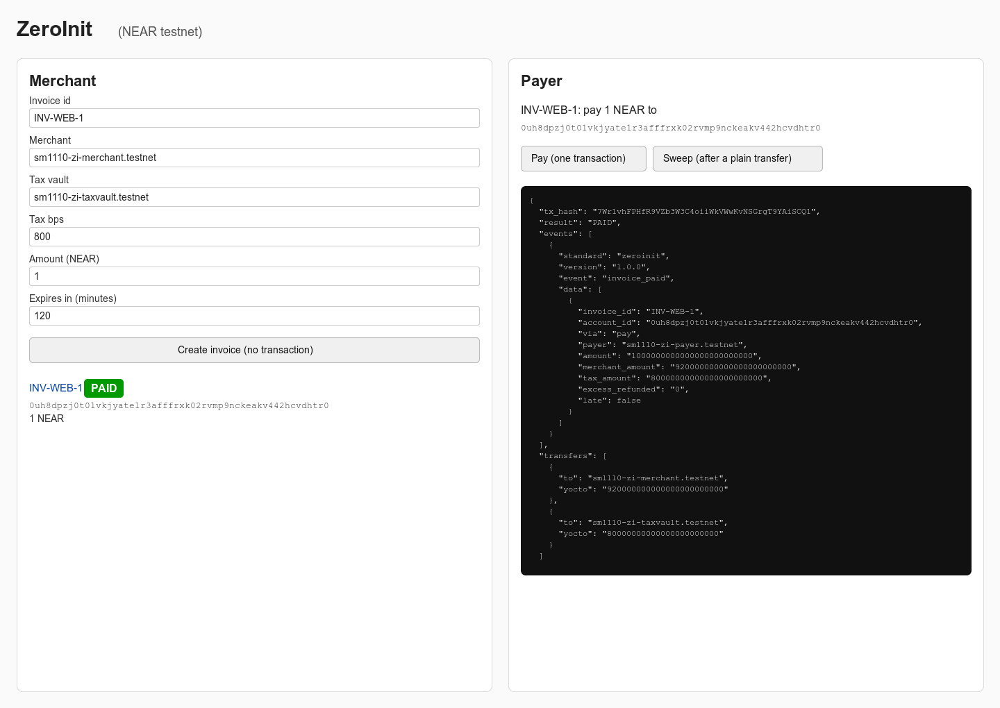

# ZeroInit: invoice addresses that cost nothing until paid (NEAR testnet)

ZeroInit gives every invoice its own NEAR address without any transaction. The address is a NEAR universal
account (`0u…`, NEP-655, protocol 88) derived from the invoice terms and an immutable contract. The payer's
single transaction creates that account, runs its contract and sends 92% to the merchant and 8% to a tax
vault. A plain transfer from any wallet or exchange also works: the money waits in the not-yet-initialized
account until anyone calls `sweep`.

Built at NEAR HACKATHON (2026-11). Track: Open Innovation (also Real-World Money).

## Status (2026-11-10)

The contract **deployed on testnet and used by the client is v3.1**: code hash `2prMzXHZVWdeHfmdqqxzb5ahLy2pWBWZjuE25EDJDaYX` (wasm sha256
`1b1dcc75…e278`, 163,771 bytes, built from `contract/` with `npm run contract:build`), global deploy tx `52dRw7RcBom9EbUJ6hCExDF5esWjsHPh5e1sUa87XyvB`, deploy burn about
**16.38 NEAR** (the operator's figure, not re-measured here). v3.1 is v3 plus one fix from the final review (F1): a token `sweep` that reads the balance while an
`ft_transfer_call` is still in flight now plans nothing and returns `CONCURRENT_PAYMENT`, instead of settling money the invoice no longer holds. Everything v3 added (NEP-141
stablecoin invoices, a `SETTLING` status, an owed ledger, a payout lock) is in v3.1. It was run live on testnet with NEAR and with **tUSDC, a testnet mock token**
(`sm1110-tusdc.testnet`, no value, no issuer): `docs/SPIKES.md` "Contract v3.1 live" lists the transactions, and every run is a fixture that replays offline (`fixtures/v31/`).
The F1 race itself was produced on testnet and is recorded (`fixtures/v31/race.json`). v3 (`Ut7EQhLD…reWa`, run live earlier the same day, `fixtures/v3/`), v2 (`4bQ61AgH…yx9zEA`)
and v1 stay on testnet as recorded history and keep replaying under their own hashes. Not done: a reproducible wasm build, a browser walk-through of the dashboard, wallet
checks, an audit and anything on mainnet. `docs/STABLECOIN.md` is the v3 interface spec; its last sections ("Live results" and "Live results (v3.1)") say what the runs showed.

## What NEAR does here

- Protocol 88 lets an account id be SHA3-256 of its future code + storage, so we can print the address first.
- `UniversalStateInit` + `FunctionCall` in one transaction: create, pay and split happen in one tx.
- Plain transfers to a `0u` id create an "uninitialized" account that only its matching state init can unlock.
- Global contracts: the invoice code is deployed once by hash (v3.1, current: `2prMzXHZVWdeHfmdqqxzb5ahLy2pWBWZjuE25EDJDaYX`); each invoice only references it. v3 (`Ut7EQhLDrvYVarHb6ZaXk6m7o9kQqYPCpyqiamvreWa`), v2
  (`4bQ61AgHWWmYXp5c3fwj9NJxS79D9R3cGZAZxHyx9zEA`) and v1 (`Amg4WXKyZe2RAyjUjtX2cgU4RW5615abgccyKtiUGW6k`) stay on testnet as recorded history:
  see "v1 → v2", "v2 → v3" and "v3 → v3.1" below.

## Repo map

- `contract/` — the **v3.1** invoice contract (Rust, near-sdk 5.30.1): NEP-141 invoices, `SETTLING`, the owed ledger, the payout lock, and the F1 fix. **Deployed** as the global
  contract `2prMzXHZ…DaYX`; `contract/res/zeroinit_invoice.wasm` is the exact wasm (a local build, not a reproducible one). The v3 wasm (`Ut7EQhLD…reWa`) is in git history (`git show 49ec835:contract/res/zeroinit_invoice.wasm`).
- `contract-v2/` — the v2 contract, its 14 tests and the exact wasm of the v2 deployment (`contract-v2/res/zeroinit_invoice.wasm`, code hash `4bQ61AgH…yx9zEA`), recorded
  history. v1 is in git history, see "v1 → v2".
- `src/` — the `zi` CLI, the frozen byte encoders (`bytes.ts`, `stateinit.ts`, `tx.ts`), `ft.ts` (NEP-141 views, exact units, token actions), RPC client, outcome parser,
  invoice docs (`/1` and `/2`), replay (v1/v2 rules, v3 rules in `replay-v3.ts`), and the optional local dashboard (`server.ts`).
- `fixtures/` — recorded RPC sessions that replay offline. **v3.1 (live, current; ids end in `-V31`):** `fixtures/v31/demo-run.json` (NEAR demo), `token-demo-run.json`
  (tUSDC by plain transfer, then sweep), `tokens.json` (one-step `ft_transfer_call`), `race.json` (the F1 race) and `late.json` (the L3 late merchant), plus `fixtures/v31/sf4.json`
  (spike S-F4 evidence, not a replay). **v3 (live, history; ids end in `-V3`):** `fixtures/v3/demo-run.json` (NEAR demo),
  `fixtures/v3/token-demo-run.json` (tUSDC by plain transfer, then sweep), `near.json`, `fixes.json`, `tokens.json`, `failures.json`, `late-resweep.json` (the L3 sweep of `LATE-V3`, added later). v2 (ids end in `-V2`):
  `fixtures/v2/demo-run.json`, `refund-cases.json`, `audit-scenarios.json`. History (v1): `fixtures/v1/`. Plus `fixtures/v2/synthetic-demo.json` and
  `fixtures/v3-synthetic-token.json` (regenerated on the v3.1 hash), both **marked synthetic** and used by parser/replay tests only. In the v2 and v3 fixtures the public block/chunk/tx signatures
  (64-byte `ed25519:` values, never read by replay) are replaced by `ed25519:REDACTED-PUBLIC-SIGNATURE`, so no secret scanner can mistake them for a key; the v1 fixtures keep theirs.
- `invoices/examples/INV-0001.json` — the frozen test-vector invoice; `invoices/v31/` — the v3.1 invoices; `invoices/v3/` — the v3 ones; `invoices/v2/` and `invoices/v1/` — the
  v2 and v1 ones (none contain secrets).
- `scripts/` — `demo.sh` (the NEAR demo) and `demo-token.sh` (the tUSDC demo), `record-v3-near.sh`, `record-v3-fixes.sh`, `record-v3-tokens.sh`, `record-v3-failures.sh`,
  `record-v3-extra.sh` (the v3 recorders that were run), `record-v31-tokens.sh`, `record-v31-race.sh`, `record-v31-late.sh` (the v3.1 recorders that were run), `race-v31.ts` (sends
  the sweep and the payment of the F1 race at the same moment), `create-late-merchant.ts` (the account for L3), `spike-sf4.ts` (S-F4), `mark-resumed.mjs`, `live-call.ts` (hand-built `ft_transfer_call` / wrong-asset calls), `plain-transfer.ts` (a bare `Transfer`, the NEAR
  exchange path), `plain-ft-transfer.ts` (register + `ft_transfer`, the token exchange path), `create-v2-unregistered-vault.ts` (the one account created for the contract-2
  re-check), `record-refund-cases.sh` and `record-audit-scenarios.sh` (the v2 recordings), `judge-offline.sh` (one-command offline check).
- `docs/` — `SPIKES.md` (live tx hashes and measured numbers), `ARCHITECTURE.md`, `STABLECOIN.md` (the v3 interface spec, build notes and live results), `plan/` (the frozen plan
  and byte-level interfaces).

## Try it offline in 2 minutes (no keys, no network) — do X, see Y

Every command below was run in this checkout, with no `.env` (`npm ci --include=dev` needs the npm
registry once).

1. `npm ci --include=dev` → installs the 3 runtime packages (`@noble/hashes`, `@noble/curves`, `@scure/base`) plus
   `near-api-js` 7.4.0 for one encoder-parity test. The flag matters: with `NODE_ENV=production` a plain `npm ci`
   skips devDependencies and the parity test cannot import `near-api-js`:

   ```
   added 68 packages, and audited 69 packages
   found 0 vulnerabilities
   ```

2. `npm test` → 169 tests, all pass (byte vectors from nearcore 2.14 and the frozen examples, the v3 201/226-byte
   state vectors, units, deployments, `/1` and `/2` documents, encoder parity with near-api-js 7.4.0, outcome/replay/CLI
   tests, the token CLI and dashboard, the v1 and v2 fixtures, the three audit scenarios and the AUD2-V2 re-sweep, the v3 replay rules on a
   **synthetic** fixture, the six **live** v3 recordings plus the L3 re-sweep, and the five **live** v3.1 recordings, each with tamper tests):

   ```
   # tests 169
   # pass 169
   # fail 0
   # skipped 0
   ```

3. `npm run zi -- vectors` → 8 lines, all `PASS`:

   ```
   PASS crockford-kat-1
   PASS crockford-kat-2
   PASS crockford-kat-3
   PASS crockford-kat-4
   PASS wallet-0u
   PASS wallet-0s
   PASS example-0u
   PASS example-0s
   ```

4. `npm run zi -- replay fixtures/v31/demo-run.json` → the **v3.1** NEAR demo, recorded live on the current contract (invoice ids `INV-1111-V31-A/B/C`, 1 NEAR), all
   `PASS`, exit 0; among the checks:

   ```
   INFO deployment v3.1 (current, deployed on testnet: v3 plus the token-sweep race fix) 2prMzXHZVWdeHfmdqqxzb5ahLy2pWBWZjuE25EDJDaYX
   PASS before-unknown-account INV-1111-V31-A NONEXISTENT
   PASS pay-tx-success INV-1111-V31-A 8gYZVNFT9DBk9PTZ7jqbe7w2iz4Fnewo4fudVYAzAwFF []
   PASS invoice-paid-after-callback INV-1111-V31-A
   PASS split-merchant INV-1111-V31-A 0.92
   PASS split-vault INV-1111-V31-A 0.08
   PASS transfer-path-uninitialized INV-1111-V31-B 1
   PASS sweep-tx-result INV-1111-V31-B CNoLGGbaUAaYZKcCyrATmU6SHgY9hzWUJx2uykBSLVgR result=PAID
   ```

5. `npm run zi -- replay fixtures/v31/token-demo-run.json` → a **tUSDC** invoice (mock token) paid by a plain `ft_transfer` (what an exchange does), then swept by
   anyone in one transaction (state init + fund + sweep):

   ```
   PASS plain-transfer-tx-success TOK-1111-V31-A 6bj1B77NHBnK8jwfRfKvVEqNw9HMUpnQQmPrqfRgBXCM []
   PASS ft-parked-balance TOK-1111-V31-A 1
   PASS sweep-tx-result TOK-1111-V31-A HnN8YwYDG9R8rap34fuTibAVEDcdUpc8xa7jrouY7efK result=PAID
   PASS ft-split-merchant TOK-1111-V31-A 0.92
   PASS ft-split-vault TOK-1111-V31-A 0.08
   ```

   `npm run zi -- replay fixtures/v31/race.json` is the **F1 race** (a token sweep while an `ft_transfer_call` is in flight; details in "v3 → v3.1"):

   ```
   PASS sweep-tx-result RACE-V31-4 8vtV5twiaxVdUvTUopcs2eUAG2hzANxdeMWSSqoYJZ9Y result=CONCURRENT_PAYMENT
   PASS concurrent-payment-plans-nothing RACE-V31-4 0 payout(s), 0 event(s), 0 failure(s)
   PASS concurrent-payment-nothing-owed RACE-V31-4 status OPEN, owed 0, paid_by null
   PASS ft-rejected-busy RACE-V31-4 used 0, 1000000 of 1000000 returned to sm1110-zi3-payer.testnet
   ```

   The other v3.1 recordings replay the same way: `tokens.json` (init, then one `ft_transfer_call` that settles, then a second one that is returned) and `late.json` (a missing
   merchant, then the L3 sweep after the account was created). The v3 recordings, made earlier the same day on the previous contract, replay under their own hash (history):
   `near.json` (pay, plain transfer + sweep, underpay, expired, double pay), `fixes.json` (a missing merchant gives `SETTLING` and no `invoice_paid`; `refund_payer`; a parked part is
   taxed), `tokens.json` (tUSDC plain path, one-step pay, overpay, underpay, expiry, token `refund_payer`, wrong asset), `failures.json` (an unregistered receiver that is retried to
   success, a wrong token, a wrong msg, little gas, a call to a never-initialized id), `demo-run.json`, `token-demo-run.json` and `late-resweep.json`, each under `fixtures/v3/`; their
   first line says `INFO deployment v3 (history, frozen: …)`.

6. `npm run zi -- replay fixtures/v2/demo-run.json` → the v2 demo run (invoice ids `INV-1111-V2-A/B/C`), all `PASS`, exit 0;
   the first line says which deployment the fixture was recorded on; among the checks:

   ```
   INFO deployment v2 (history, frozen: fixes contract-1/2/3; verify and replay only) 4bQ61AgHWWmYXp5c3fwj9NJxS79D9R3cGZAZxHyx9zEA
   PASS before-unknown-account INV-1111-V2-A
   PASS pay-tx-success INV-1111-V2-A B7pwrVigiBoziDyFakYa5kFE1JMDkYtg8BNMm2k7XbEz result=PAID
   PASS split-merchant INV-1111-V2-A 0.92
   PASS split-vault INV-1111-V2-A 0.08
   PASS after-status-PAID INV-1111-V2-A
   PASS transfer-path-uninitialized INV-1111-V2-B 1
   PASS sweep-tx-success INV-1111-V2-B HUnCWN2kVy3HQVsVZAL3pL3VrcuJAH6XwxDQUgW8Vyig result=PAID
   PASS refund-event INV-1111-V2-C REFUNDED_UNDERPAID
   ```

7. `npm run zi -- replay fixtures/v2/refund-cases.json` → all `PASS`, exit 0; among them:

   ```
   PASS refund-event REF-UNDER-V2 REFUNDED_UNDERPAID
   PASS refund-event REF-EXPIRED-V2 REFUNDED_EXPIRED
   PASS refund-event REF-TWICE-V2 REFUNDED_NOT_OPEN
   PASS split-merchant REF-OVER-V2 0.092
   PASS transfer-path-uninitialized REF-SWEEPLOW-V2 0.05
   PASS sweep-underpaid-reverted REF-SWEEPLOW-V2 2pw7QeQG8JFvzZNQ1hKGwXTwWohnsiE6Rm8Fp8bRoXJR
   ```

8. `npm run zi -- replay fixtures/v2/audit-scenarios.json` → the three audit findings re-run live on v2, plus the AUD2-V2 re-sweep, all `PASS`:

   ```
   PASS before-parked-account AUD1-V2 0.1
   PASS pay-tx-success AUD1-V2 678rsqwkrqP6af9EKywJqJzYPKyU9oaFqd9YmRDmjsqm result=REFUNDED_EXPIRED
   PASS split-vault AUD1-V2 0.008
   PASS refund-already-funded AUD3-V2 refunded 0.1 to sm1110-zi-payer.testnet
   PASS transfer-failures-recorded AUD2-V2 1 failed, 1 transfer_failed events
   PASS sweep-tx-success AUD2-V2 HECqnmtEyo7nK7stnh9VoxPHLsmTJyJY3qX3ATUtpife result=TAX_RESENT
   ```

9. `npm run zi -- replay fixtures/v1/demo-run.json` → the original v1 recordings still replay (v1 is accepted for
   verifying history only, whatever `ZI_CODE_HASH` says); it reports the deployment it replayed:

   ```
   INFO deployment v1 (history, frozen: known limitations contract-1/2/3; verify only, never pay) Amg4WXKyZe2RAyjUjtX2cgU4RW5615abgccyKtiUGW6k
   PASS pay-tx-success INV-1111-A BdzRBcFfwFqxc3TXXB481HcMna1YVYrrj62Z2h48pBTA result=PAID
   PASS sweep-tx-success INV-1111-B 5P2rkpkVQLgBf5poR84kgFrFxgcGf6osEHAzBLHrvKaa result=PAID
   ```

   `fixtures/v1/refund-cases.json` replays the same way.

One command for the whole judge path: `bash scripts/judge-offline.sh` → `npm ci --include=dev`, `npm test`, `vectors`, the five v3.1 replays, the seven v3 replays, the three
v2 replays, the two v1 replays and an offline `verify` of every v3.1, v3, v2 and v1 invoice; its last line is:

```
JUDGE-OFFLINE: ALL PASS
```

(We ran it in this checkout with `npm run -s zi --` mapped to `node src/cli.ts`, because `npm run` printed none of the CLI output in our sandbox; it ended with that line and
no `FAIL` line.)

## Check the live testnet claims (read-only, no keys)

The invoices under `invoices/v31/` (current contract v3.1, NEAR and tUSDC), `invoices/v3/` (v3), `invoices/v2/` (v2) and `invoices/v1/` (v1) were paid on testnet (protocol 88). These commands
only read RPC; they work from a clean clone with no `.env`. The default endpoint is `https://rpc.testnet.fastnear.com`
(`https://rpc.testnet.near.org` started answering HTTP 429 "endpoint is deprecated" on 2026-11-10; set `ZI_RPC_URL` to use another one).

1. `npm run zi -- verify INV-1111-V31-A` → the address and the state-init bytes are recomputed from the terms and the pinned code hash (`ZI_CODE_HASH`, default v3.1
   `2prMzXHZ…DaYX`, never the invoice file's own `code_hash`), then compared with the chain. It also says which deployment the invoice uses. Any `FAIL` makes the command exit 1
   (we ran this on 2026-11-10, and the same on all 8 invoices of `invoices/v31/` and, under their own hash, on `LATE-V3`: no `FAIL`; earlier the same day all 26 invoices of
   `invoices/v3/` passed):

   ```
   PASS code-hash-trusted 2prMzXHZVWdeHfmdqqxzb5ahLy2pWBWZjuE25EDJDaYX
   INFO deployment v3.1 (current, deployed on testnet: v3 plus the token-sweep race fix)
   PASS format-matches-deployment zeroinit-invoice/2
   PASS id-from-terms 0u6c0024qear4qp5f447xvkjsgmz5mrq5x1c1kjjr0ddp3eer9s1t0
   PASS raw-from-terms
   PASS doc-fields-from-terms
   PASS code-hash-onchain 2prMzXHZVWdeHfmdqqxzb5ahLy2pWBWZjuE25EDJDaYX
   PASS terms-onchain
   PASS no-access-keys
   INFO status=PAID
   ```

   `npm run zi -- verify TOK-1111-V31-A` does the same for the tUSDC invoice and adds `PASS token-allowed tUSDC sm1110-tusdc.testnet` and
   `PASS token-metadata-onchain tUSDC 6` (the token's `ft_metadata` is compared with the client allow-list). `verify` of a v2 or v1 invoice
   (`INV-1111-V2-A`, `INV-1111-A`) checks it against its own historical hash and prints `INFO deployment v2 (history…` / `v1 (history…`; `zi pay`, `zi sweep` and
   `zi init` refuse historical invoices.

2. Open `https://testnet.nearblocks.io/txns/8gYZVNFT9DBk9PTZ7jqbe7w2iz4Fnewo4fudVYAzAwFF` → one transaction with exactly two actions, `UniversalStateInit` + `pay`,
   receiver `0u6c0024qear4qp5f447xvkjsgmz5mrq5x1c1kjjr0ddp3eer9s1t0`, result `PAID`, and transfers of `0.92` NEAR to `sm1110-zi3-sweeper.testnet` (the merchant in the demo) and
   `0.08` NEAR to `sm1110-zi3-taxvault.testnet`, with `invoice_paid` logged by the `on_settled` callback after both transfers succeeded. If nearblocks renders `0u…` ids
   poorly, the RPC `tx` method returns the same JSON and `zi replay` checks it offline.

3. `npm run zi -- status INV-1111-V31-B` → the invoice that was paid by a plain transfer (no state init) and later swept:

   ```
   STATE INITIALIZED status=PAID paid_by=null balance=0 storage=399
   ```

   Plain-transfer tx `AzASJAvoViqMhFcUX38MtJvMGijdwAc3xCi2rtA3qujd`; sweep tx `CNoLGGbaUAaYZKcCyrATmU6SHgY9hzWUJx2uykBSLVgR`. `paid_by=null` is expected on this path:
   `sweep()` does not know who transferred the funds. `npm run zi -- status TOK-1111-V31-A` shows the tUSDC one (`STATE INITIALIZED status=PAID paid_by=null … tokens=0 tUSDC
   owed_merchant=0 owed_tax=0 owed_payer=0`); its plain `ft_transfer` is `6bj1B77NHBnK8jwfRfKvVEqNw9HMUpnQQmPrqfRgBXCM`, the sweep `HnN8YwYDG9R8rap34fuTibAVEDcdUpc8xa7jrouY7efK`
   (0.92 / 0.08 tUSDC).

4. Contract integrity: `shasum -a 256 contract/res/zeroinit_invoice.wasm` → `1b1dcc7515f2b9d6bada0540ed20833dd3050d074e155fb8d489ac2afe01e278` (163,771 bytes). That digest
   is the base58 code hash `2prMzXHZVWdeHfmdqqxzb5ahLy2pWBWZjuE25EDJDaYX`; `zi verify` checks that the invoice account's on-chain `global_contract_hash` equals it. This is
   the exact wasm installed by the v3.1 global deploy tx `52dRw7RcBom9EbUJ6hCExDF5esWjsHPh5e1sUa87XyvB` (the operator's deploy, built from commit `49ec835`; the deploy burn of about
   **16.38 NEAR** is the operator's figure, not measured by this run). The previous v3 wasm (digest `0724781d…0b1f`, 161,213 bytes, hash `Ut7EQhLD…reWa`) was installed by
   `43D4EifRGJJBtWUVhFPXPFsZqooPwz1czD8LwRz6sjYT` (burn about 16.1226 NEAR: balance 27 → 10.8774031 NEAR, gas included); it is history now.
   History: `shasum -a 256 contract-v2/res/zeroinit_invoice.wasm` → `3562e978e6924a2c538e9906fc42d15a652947891f18f7816e3c7807d20f622f` (82,942 bytes, hash `4bQ61AgH…yx9zEA`),
   deployed by `DvNnUtvqMg5Q5e2Mn4fMx7GYBFNFhTo7z9wo64szAFKG` (signer `sm1110-zi-deployer.testnet`, burn 8.2949 NEAR). The v1 wasm (digest `912ae75e…c3c9`, hash `Amg4WXKy…GW6k`)
   was deployed by `DSXd2Sjq59zRF2ZX9j3D8SMYd6GZ44XpsW1aJbKfpJ1h` (burn 7.8526 NEAR); `git show e5581e8:contract/res/zeroinit_invoice.wasm` prints it.

5. History checks that still work (v2): `npm run zi -- verify INV-1111-V2-A`, `npm run zi -- status INV-1111-V2-B`, and the v2 transactions in the table "v1 → v2" below.

### Rebuild the wasm (reproducible build)

The **v2** wasm (history) lives in `contract-v2/`. A judge's fresh-clone rebuild with `cargo near build reproducible-wasm`
produced a byte-identical wasm: sha256 `3562e978e6924a2c538e9906fc42d15a652947891f18f7816e3c7807d20f622f`, 82,942 bytes.
We did not re-run that build ourselves for this note (Docker is not usable in the environment where these fixes were
made). To repeat it you need Docker running, cargo-near 0.23.0 and a clean git checkout (the reproducible build refuses
a dirty tree):

```bash
cd contract-v2
cargo near build reproducible-wasm
shasum -a 256 target/near/zeroinit_invoice.wasm   # expect 3562e978…f622f, same as contract-v2/res/zeroinit_invoice.wasm
```

`contract/` (v3, the deployed one) is a plain local build, not a reproducible one: `npm run contract:build` produced
161,213 bytes / `0724781d…0b1f`. Do not quote it as reproducible until a reproducible build has been compared.

The build settings live in `[package.metadata.near.reproducible_build]` in both `contract/Cargo.toml` and
`contract-v2/Cargo.toml`. Their `image_digest` is still `UNSET`: the digest of the build image has not been recorded
yet, so the image is pinned by tag only. Also, the tag `0.23.0-rust-1.95.0` is not in Docker Hub's tag list for
`sourcescan/cargo-near` (checked on 2026-11-10), so `image` needs to be set to the image the judge actually used before
the digest can be written. The operator should do both after a run with Docker: read the digest with
`docker images --digests sourcescan/cargo-near` and put it in `image_digest`.

## Run it yourself on testnet

This walkthrough runs on the **deployed v3** contract (NEAR, then tUSDC). The recorded runs in `fixtures/v3/` were made with the project's own CLI and the operator's
accounts, exactly the commands below; the account-creation commands in step 1 are the near-cli-rs form the operator used for the earlier accounts and are not part of the
recorded v3 runs.

Testnet only: `src/config.ts` refuses any other network and any mainnet RPC URL. You need Node 22.22.x; account
creation uses near-cli-rs. The steps below assume you are in the repo root.

1. Pick a prefix that is still free on testnet; `example` stands for it below. Create four accounts (the legacy
   keychain stores their keys under `~/.near-credentials/testnet/`):

   ```bash
   export P=example
   for a in deployer merchant taxvault payer; do
     near account create-account sponsor-by-faucet-service "$P"-zi-$a.testnet \
       autogenerate-new-keypair save-to-legacy-keychain network-config testnet create
   done
   ```

   Each command prints the new account and a transaction hash. The payer needs a little NEAR; the faucet grant
   is enough for this walkthrough, top up at https://near-faucet.io/ if it is not.

2. No deploy needed: `contract/res/zeroinit_invoice.wasm` is already a global contract on testnet with code hash `2prMzXHZVWdeHfmdqqxzb5ahLy2pWBWZjuE25EDJDaYX` (v3.1).
   Optionally deploy your own copy (this burns about 16.4 NEAR, the cost the operator reported for the v3.1 deploy; the hash of an identical wasm is the same, so only a
   changed wasm gives a new hash):

   ```bash
   near contract deploy-as-global use-file contract/res/zeroinit_invoice.wasm \
     as-global-hash "$P"-zi-deployer.testnet network-config testnet sign-with-legacy-keychain send
   ```

3. `cp .env.example .env` and fill it in (uncomment the account and key lines). `.env.example` prefills the v3 hash and the FastNEAR RPC; change the hash only if you
   deployed your own changed global contract in step 2. Set `ZI_PAYER_ACCOUNT=example-zi-payer.testnet`, `ZI_SWEEPER_ACCOUNT=example-zi-merchant.testnet`,
   `ZI_TAXVAULT_ACCOUNT=example-zi-taxvault.testnet`, and for `ZI_PAYER_KEY` / `ZI_SWEEPER_KEY` paste the
   `private_key` values from `~/.near-credentials/testnet/example-zi-payer.testnet.json` and
   `~/.near-credentials/testnet/example-zi-merchant.testnet.json`. `.env` is gitignored: never commit it.
   Load it in every shell with `set -a; source .env; set +a`.

4. Issue an invoice. It needs no key and the address is computed locally; by default it makes two read-only RPC calls
   (network check, and that the merchant and tax vault accounts exist). Add `--offline` to skip them:

   ```bash
   npm run zi -- invoice new --id INV-RUN-1 --merchant example-zi-merchant.testnet \
     --tax-vault example-zi-taxvault.testnet --tax-bps 800 --amount 0.1 --expires-in 2h
   npm run zi -- status INV-RUN-1
   ```

   ```
   INVOICE INV-RUN-1
   ACCOUNT 0u…                                  (54 characters, derived from the terms and the code hash)
   PAY 0.1 NEAR before 2026-…
   FILE invoices/INV-RUN-1.json
   STATE NONEXISTENT
   ```

5. Pay it in one transaction (signs with `ZI_PAYER_KEY`; the expected shape is from our recorded run, the tx hash
   and account id are yours):

   ```bash
   npm run zi -- pay INV-RUN-1
   ```

   ```
   TX …
   RESULT PAID
   EVENT invoice_paid {"invoice_id":"INV-RUN-1", … "merchant_amount":"92000000000000000000000","tax_amount":"8000000000000000000000", …}
   TRANSFER example-zi-merchant.testnet 0.092
   TRANSFER example-zi-taxvault.testnet 0.008
   LINK https://testnet.nearblocks.io/txns/…
   STATE INITIALIZED status=PAID paid_by=example-zi-payer.testnet balance=0 storage=…
   ```

6. Verify it, then try the wallet path and a refund:

   ```bash
   npm run zi -- verify INV-RUN-1
   # PASS code-hash-trusted / INFO deployment v3.1 (current… / PASS format-matches-deployment / PASS id-from-terms 0u… / PASS raw-from-terms / PASS doc-fields-from-terms / PASS code-hash-onchain 2prMzXHZ… / PASS terms-onchain /
   # PASS no-access-keys / INFO status=PAID

   npm run zi -- invoice new --id INV-RUN-2 --merchant example-zi-merchant.testnet \
     --tax-vault example-zi-taxvault.testnet --tax-bps 800 --amount 0.1 --expires-in 2h
   ACC=$(node -e "console.log(require('./invoices/INV-RUN-2.json').account_id)")
   node scripts/plain-transfer.ts "$ACC" 0.1      # a bare Transfer, exactly what a wallet or exchange sends
   npm run zi -- status INV-RUN-2                 # STATE UNINITIALIZED balance=0.1
   npm run zi -- sweep INV-RUN-2                  # RESULT PAID; anyone can send the sweep

   npm run zi -- invoice new --id INV-RUN-3 --merchant example-zi-merchant.testnet \
     --tax-vault example-zi-taxvault.testnet --tax-bps 800 --amount 0.1 --expires-in 2h
   npm run zi -- pay INV-RUN-3 --amount 0.05      # RESULT REFUNDED_UNDERPAID, 0.05 goes back to the payer
   ```

   On a real TTY, `near tokens example-zi-payer.testnet send-near "$ACC" '0.1 NEAR' network-config testnet
   sign-with-legacy-keychain send` sends the same plain transfer. In our headless runs near-cli-rs printed
   `does not exist on testnet` and then needed an interactive confirmation, so the scripts use
   `scripts/plain-transfer.ts` (same single `Transfer` action, signed with the payer key).

7. tUSDC (a **testnet mock** token; its owner mints it, so ask for some, or run your own copy of the `test-usdc` token and set `ZI_TUSDC_ACCOUNT`). The merchant and tax vault
   must be registered on the token (NEP-145), the payer must hold tUSDC. The commands are the ones recorded in `fixtures/v3/tokens.json` and `fixtures/v3/failures.json`:

   ```bash
   npm run zi -- token register example-zi-merchant.testnet      # once per account; the payer key pays the 0.00125 NEAR storage deposit
   npm run zi -- token register example-zi-taxvault.testnet
   npm run zi -- invoice new --id TOK-RUN-1 --merchant example-zi-merchant.testnet --tax-vault example-zi-taxvault.testnet \
     --tax-bps 800 --amount 1 --expires-in 2h --token tUSDC     # checks the allow-list, ft_metadata and the registrations
   npm run zi -- pay TOK-RUN-1 --plain       # exchange path: registers the id, sends a bare ft_transfer; STATE NONEXISTENT tokens_parked=1 tUSDC
   npm run zi -- sweep TOK-RUN-1             # anyone: [UniversalStateInit, fund, sweep] in one tx; 0.92 / 0.08 tUSDC, invoice_paid from on_settled
   npm run zi -- invoice new --id TOK-RUN-2 … --token tUSDC
   npm run zi -- pay TOK-RUN-2               # one-step path: register id, init + fund, then ft_transfer_call; exit 0 only on invoice_paid
   ```

   If a receiver is not registered, its payout fails, the share stays owed (`SETTLING`, `transfer_failed`), and after `zi token register <account>` a `zi sweep` delivers
   it (recorded as `UNREG-V3`); `zi refund-payer <id>` returns undelivered shares to the payer after the invoice's grace period (recorded as `TOK-V3-G`).

8. Optional local dashboard:

   ```bash
   npm run zi -- serve --port 8787
   # SERVE http://127.0.0.1:8787
   ```

   Open it, create an invoice (no transaction), pay, or send a plain transfer and sweep. The server signs with
   the payer/sweeper keys from `.env` and binds `127.0.0.1` only. Statuses load when the page opens, after each
   action, and when you click **Refresh statuses** (no polling, to stay under public RPC rate limits).

   

## How it works

```
 MERCHANT (laptop, no keys needed to issue)                PAYER
 ┌────────────────────────────────────┐            ┌───────────────────────────────┐
 │ zi invoice new  ── terms ──┐       │            │ (A) zi pay  (signs with       │
 │                            ▼       │  invoice   │     ZI_PAYER_KEY)             │
 │  stateinit.ts: STATE borsh → raw   │  doc /     │ (B) any wallet / exchange:    │
 │  → SHA3-256 → "0u…" address        │──address──►│     plain Transfer to 0u…     │
 │  invoices/INV-x.json               │            └───────────────┬───────────────┘
 │ zi status / verify / receipt  ◄────┼──── JSON-RPC (read) ───┐   │ signed tx (A) or Transfer (B)
 │ zi sweep (any account, gas only) ──┼──── signed tx ────┐    │   │
 └────────────────────────────────────┘                   ▼    │   ▼
 ═══════════════════ trust boundary: NEAR testnet (protocol 88) ═══════════════════════
   global contract code (by hash H)          invoice account 0u… = hash(H, STATE)
   deployed once by zi-deployer   ─────────► NONEXISTENT → (B) UNINITIALIZED (funds parked)
                                             → UniversalStateInit installs code H + STATE
                                             → pay()/sweep(): Promise transfers
                                                 ├─► merchant  (amount − tax)
                                                 ├─► tax_vault (tax)
                                                 └─► payer     (refund / excess)
```

The id is computed offline: `0u` + Crockford-base32(SHA3-256(borsh
`UniversalStateInit{code: CodeHash, data: {STATE}, access_keys: {}}`)). `STATE` is the borsh encoding of the
invoice terms (frozen layout in `docs/plan/INTERFACES.md` §2.3, implemented in `src/stateinit.ts`). No key
exists for an invoice account: `access_keys` is empty, the code is fixed by hash, and the terms are inside the
address.

Account lifecycle:

```
             (merchant computes id offline; nothing on chain)
NONEXISTENT ──── plain Transfer (any wallet/exchange) ────► UNINITIALIZED (holds NEAR, no code)
     │                                                           │
     │ [UniversalStateInit, FunctionCall pay(deposit)]           │ [UniversalStateInit, FunctionCall sweep()]
     ▼                                                           ▼
  INITIALIZED, status OPEN → pay() splits → PAID      INITIALIZED, status OPEN → sweep() splits → PAID
```

Contract methods (v3; args are `{}` unless noted; there is no init method, no owner and no key):

| Method | Payable | What it does |
|---|---|---|
| `pay()` | yes | NEAR invoices: splits the attached deposit per `tax_bps` (92/8 at 800 bps), or refunds it (table below) |
| `ft_on_transfer(sender_id, amount, msg)` | no (called by the token) | token invoices: accepts a `ft_transfer_call` whose `msg` is exactly `{"action":"pay"}` (optionally with this invoice's `invoice_id`) and whose caller is the invoice's token, or returns the amount unused with a `payment_rejected` reason |
| `sweep()` | no | settles funds that arrived without a call (a plain transfer / plain `ft_transfer`); re-sends owed shares to their own recipient; forwards extra funds (taxed) |
| `refund_payer()` | no | after the invoice's grace period, pays the undelivered shares of a `SETTLING` invoice back to the payer (`paid_by`) and nobody else |
| `fund()` | yes | token invoices: takes a NEAR deposit (the client sends 1,000 yocto) so the account can attach 1 yocto to each `ft_transfer` |
| `get_invoice()`, `get_owed_tax()` | view | the invoice as JSON (`u64`/`u128` are strings, including `owed_*`, `grace_ms`, `token`, `busy_until_ms`) / the tax share not yet delivered |
| `on_settled`, `on_token_balance` | private | callbacks: `on_settled` checks every payout, records failures per recipient (`owed_*`), emits `transfer_failed` and is the **only** place `invoice_paid` is emitted |

Statuses: `OPEN`, `PAID` (every share delivered), `EXPIRED`, `SETTLING` (money accepted, shares in flight or failed), `REFUNDED` (the payer got the undelivered shares back).
An invoice that expired untouched stays `OPEN` until some call (a late `pay`, a late `ft_transfer_call`) sets `EXPIRED`.

`pay()` rules (NEAR invoices), checked in this order (`d` = attached deposit, `now` = block timestamp, `parked` = free balance − `d` − owed):

| # | Condition | Result |
|---|---|---|
| 1 | the invoice is a token invoice | `REFUNDED_WRONG_ASSET`; `d` goes back |
| 2 | status is not `OPEN` | `REFUNDED_NOT_OPEN`; `d` goes back to the payer |
| 3 | `now > expires_at_ms` | `REFUNDED_EXPIRED`; status becomes `EXPIRED`; `d` goes back |
| 4 | a payout is in flight (lock) | `REFUNDED_BUSY` |
| 5 | `parked ≥ amount` | funds parked by a plain transfer already cover the invoice: they are settled like `sweep()` (taxed) and `d` goes back in full (`payment_refunded`, reason `already_funded`) |
| 6 | `d < amount` | `REFUNDED_UNDERPAID`; status stays `OPEN`; `d` goes back |
| 7 | otherwise | status `SETTLING`, tax = `amount × tax_bps / 10000` (floor) to the tax vault, net to the merchant, any excess back to the payer; the callback then sets `PAID` and emits `invoice_paid` (the transaction returns `PAID`), or records what failed (`PAYOUT_PENDING`) |

`sweep()` (NEAR, `avail` = balance − owed − storage reserve; the reserve is 0 while `storage_usage ≤ 770` B): first re-sends owed shares (tax to the vault, merchant share to the
merchant, payer share to `refund_to`), then: `OPEN`/`EXPIRED`-never-paid with `avail ≥ amount` settles **all** of `avail` through the tax split (`PAID`, `late: true` after expiry);
`OPEN` with less panics `UNDERPAID` (funds stay parked); `EXPIRED` with less releases `avail` pro rata (taxed); `PAID` with `avail > 0` splits the extra the same way (`EXTRA_SWEPT`).
Token `sweep` reads `ft_balance_of` in a callback and runs the same plan; it returns the value `UNDERPAID` / `NOTHING_TO_SWEEP` (it cannot panic in a callback) and needs at least
150 Tgas. While a payout is in flight (5-minute lock) a second `sweep` panics `PAYOUT_IN_FLIGHT`.

Transactions (hand-encoded V0, ed25519 over SHA-256, because near-api-js 7.4.0 cannot serialize action 15):

| Name | signer | receiver | actions |
|---|---|---|---|
| PAY (NEAR) | payer | invoice `0u…` id | `[UniversalStateInit{raw, deposit:0}, FunctionCall{"pay", "{}", 100 Tgas, deposit = amount}]` |
| SWEEP (NEAR) | anyone | invoice `0u…` id | `[UniversalStateInit{raw, deposit:0}, FunctionCall{"sweep", "{}", 100 Tgas, 0}]` |
| PLAIN TRANSFER | any wallet | invoice `0u…` id | `[Transfer{amount}]` |
| INIT (token) | payer / merchant | invoice `0u…` id | `[UniversalStateInit, FunctionCall{"fund", 10 Tgas, 1000 yocto}]` |
| PAY (token) | payer | the token | `[FunctionCall{"ft_transfer_call", {receiver_id: invoice, amount, msg}, 200 Tgas, 1 yocto}]`; the final value is the amount **used** (`"1000000"` settled, `"0"` rejected) |
| PLAIN `ft_transfer` (token) | any wallet / exchange | the token | `[FunctionCall{"ft_transfer", 1 yocto}]` after the invoice id is registered with `storage_deposit` |
| SWEEP (token) | anyone | invoice `0u…` id | `[UniversalStateInit, FunctionCall{"fund"}, FunctionCall{"sweep", "{}", 200 Tgas}]` (state init and fund only when needed) |

Each state change emits an `EVENT_JSON:` log line (`invoice_paid`, `payment_refunded`, `payment_rejected`, `extra_swept`, `transfer_failed`, `tax_resent`, `owed_resent`,
`owed_reclaimed`); `zi` prints it as `EVENT …` and `zi replay` parses the JSON. Merchant, tax and refund payouts are separate receipts joined into one `on_settled`
callback. If one fails (a missing account, an unregistered token receiver), NEAR returns the amount to the invoice account, the callback records it as owed and emits
`transfer_failed`, and **no `invoice_paid` is emitted**; a later `sweep` re-sends it to that recipient only, and `refund_payer` can return it to the payer after the grace period
(see "v2 → v3"). `zi pay` / `zi sweep` print the failed receipt as `TRANSFER_FAILED …` and exit 1.

## Claims and how to verify each

| Claim | Verify with | Expected |
|---|---|---|
| Issuing an invoice needs no transaction | `npm run zi -- invoice new --id TEST-1 --merchant example-zi-merchant.testnet --tax-vault example-zi-taxvault.testnet --tax-bps 800 --amount 0.1 --expires-in 2h --offline` (the deployed code hash is built in, so no `.env` is needed; without `--offline` it also checks over RPC that merchant and tax vault exist on testnet) | `INVOICE`/`ACCOUNT`/`PAY`/`FILE` lines; no RPC call |
| The address commits to the terms and code | `npm run zi -- verify INV-1111-V31-A --offline` | `PASS code-hash-trusted 2prMzXHZ…`, `INFO deployment v3.1 (current…`, `PASS id-from-terms 0u6c0024…s1t0`, `PASS raw-from-terms` |
| One tx creates + pays + splits (NEAR) | `npm run zi -- replay fixtures/v31/demo-run.json` (or the nearblocks link in the previous section) | `PASS pay-tx-success INV-1111-V31-A 8gYZVNFT… []`, `PASS split-merchant INV-1111-V31-A 0.92`, `PASS split-vault INV-1111-V31-A 0.08`, `PASS invoice-paid-after-callback INV-1111-V31-A` |
| Plain transfers are safe before init | `npm run zi -- replay fixtures/v31/demo-run.json` | `PASS transfer-path-uninitialized INV-1111-V31-B 1`, `PASS sweep-tx-result INV-1111-V31-B CNoLGGba… result=PAID` |
| A stablecoin invoice (tUSDC, a testnet mock) is paid by a plain `ft_transfer` and swept by anyone | `npm run zi -- replay fixtures/v31/token-demo-run.json` | `PASS ft-parked-balance TOK-1111-V31-A 1`, `PASS ft-split-merchant TOK-1111-V31-A 0.92`, `PASS ft-split-vault TOK-1111-V31-A 0.08` |
| A token `sweep` that races an in-flight `ft_transfer_call` plans nothing (F1, fixed in v3.1) | `npm run zi -- replay fixtures/v31/race.json` | `PASS sweep-tx-result RACE-V31-4 8vtV5twi… result=CONCURRENT_PAYMENT`, `PASS concurrent-payment-plans-nothing RACE-V31-4 0 payout(s), 0 event(s), 0 failure(s)`, `PASS ft-rejected-busy RACE-V31-4 used 0, 1000000 of 1000000 returned …`, then the retry settles (`PASS ft-split-merchant RACE-V31-4 0.92`) |
| A missing NEAR merchant: owed, then paid after the account exists (L3) | `npm run zi -- replay fixtures/v31/late.json` and `fixtures/v3/late-resweep.json` | `PASS owed-after-failure LATE-V31 …`, `PASS owed-resent LATE-V31 late.sm1110-zi3-merchant.testnet 92000000000000000000000`; the same for the v3 invoice `LATE-V3` |
| A token payment through `ft_transfer_call` settles, or is returned whole with a reason | `npm run zi -- replay fixtures/v3/tokens.json` and `fixtures/v3/failures.json` | `PASS ft-excess-refunded TOK-V3-C …`, `PASS ft-rejected-underpaid TOK-V3-D used 0, 500000 of 500000 returned …`, `ft-rejected-expired`, `ft-rejected-not_open`, `ft-rejected-wrong_token`, `ft-rejected-bad_msg`, `ft-rejected-low_gas` |
| `invoice_paid` is never emitted before the payouts succeeded (v2 residual fixed) | `npm run zi -- replay fixtures/v3/fixes.json` and `failures.json` | `PASS invoice-paid-after-callback TAX-V3`; for `LATE-V3` and `UNREG-V3` a failed payout gives `PAYOUT_PENDING` and no `invoice_paid` (`test/live-v3.test.ts`) |
| A failed payout is owed, retried to its own recipient, or refunded to the payer after the grace period (v2 residual fixed) | `npm run zi -- replay fixtures/v3/failures.json`, `fixes.json`, `tokens.json` | `PASS owed-resent UNREG-V3 sm1110-zi3-unreg.testnet 920000`, `PASS refund-payer-to-paid-by REFUND-V3 sm1110-zi3-payer.testnet`, `owed-after-failure …` |
| A partly parked amount is taxed too (v2 residual fixed) | `npm run zi -- replay fixtures/v3/fixes.json` | `TAX-V3`: vault 0.008 + 0.004 (`extra_swept`), `PASS split-matches-terms TAX-V3 …` |
| The tax split is the invoice's own rule | any v3 replay | `PASS split-matches-terms <id> 0.1 -> merchant 0.092, tax 0.008` |
| Nobody holds keys to invoice accounts | `npm run zi -- verify INV-1111-V31-A` (RPC `view_access_key_list`) | `PASS no-access-keys` |
| Underpay / expired / double pay are refunded | `npm run zi -- replay fixtures/v3/near.json` | `after-status-OPEN INV-V3-C`, `after-status-EXPIRED INV-V3-D`, and the results `REFUNDED_UNDERPAID`, `REFUNDED_EXPIRED`, `REFUNDED_NOT_OPEN` (`test/live-v3.test.ts`) |
| The deployed code is the committed wasm | `shasum -a 256 contract/res/zeroinit_invoice.wasm` and `npm run zi -- verify INV-1111-V31-A` | digest `1b1dcc75…e278` = base58 `2prMzXHZ…DaYX`; `PASS code-hash-onchain` |
| v2: the tax vault is not skipped after expiry (contract-1) | `npm run zi -- replay fixtures/v2/audit-scenarios.json` | `PASS refund-event AUD1-V2 REFUNDED_EXPIRED`, `PASS sweep-tx-success AUD1-V2 8WQr2GUm… result=PAID`, `PASS split-vault AUD1-V2 0.008` |
| v2: a payer who already sent a plain transfer is not charged twice (contract-3) | same replay | `PASS refund-already-funded AUD3-V2 refunded 0.1 to sm1110-zi-payer.testnet`, `PASS split-vault AUD3-V2 0.008` |
| v2: a failed transfer is recorded, the tax stays owed, and a later sweep delivers it (contract-2) | same replay | `PASS transfer-failures-recorded AUD2-V2 1 failed, 1 transfer_failed events`, `PASS sweep-tx-success AUD2-V2 HECqnmty… result=TAX_RESENT` (the second sweep, after the vault account was created) |
| The v2 and v1 recordings still check out (history) | `npm run zi -- replay fixtures/v2/demo-run.json`, `fixtures/v1/demo-run.json` and `npm run zi -- verify INV-1111-A --offline` | `INFO deployment v2 (history…` / `v1 (history, frozen…`, all `PASS` |

## Limits (honest)

- **tUSDC is a testnet mock, not a stablecoin.** The token `sm1110-tusdc.testnet` is a copy of the `test-usdc` mock (6 decimals, owner-only mint): it has no value and no
  issuer behind it. The contract does not know tUSDC; each invoice names one NEP-141 token in its terms (so in its address), the contract accepts only that token, and the
  client allow-list (`src/config.ts`, `ZI_TUSDC_ACCOUNT`) pins symbol, decimals and account. On mainnet the allow-list would name a real issuer's NEP-141 contract (for
  example a USDC or USDT contract that the issuer runs on NEAR) with its real decimals, checked against `ft_metadata`; that was not tried, and mainnet is out of scope.
- **Token limits.** One token per invoice, `0u` only for tokens (`0s` is refused), testnet only. A plain NEAR transfer to a token invoice and a plain `ft_transfer` of a
  different token are not recoverable (the NEAR stays on the account, the other token sits on its own contract). The receiver of every token payout must be registered on
  the token (NEP-145): an unregistered merchant or vault makes that payout fail (recorded as owed, see "v2 → v3"); `zi invoice new` refuses unregistered ones unless `--offline`.
- **Testnet only.** `src/config.ts` refuses a non-testnet network or a mainnet RPC URL, and every signing path (the CLI,
  the dashboard server, `scripts/plain-transfer.ts`) asserts RPC `chain_id == testnet` before it uses a key; mainnet was not tested.
- **Exit codes.** `zi verify`, `zi receipt` and `zi replay` exit 1 on any failed check. `zi pay` exits 1 unless the result is
  `PAID` (a `REFUNDED_*` result means the deposit came back); the dashboard answers 409 with `paid:false` in that case. `zi pay` and `zi sweep` also exit 1 (with a `WARNING` and
  `TRANSFER_FAILED` lines) when a transfer failed downstream. On v3, `zi pay` exits 1 on `SETTLING`/`PAYOUT_PENDING` (it says `NOT PAID (yet)` and to run `zi sweep`),
  a token `zi pay` exits 0 only when `invoice_paid` was seen, the dashboard answers 202 with `paid:false, pending:true`, and a token sweep exits 1 on `UNDERPAID`,
  `NOTHING_TO_SWEEP`, `NEEDS_YOCTO`, `BALANCE_UNAVAILABLE`, `CONCURRENT_PAYMENT` (the last exists since v3.1; see "v3 → v3.1").
- **Contract limits that stay (v3 and v3.1).** The contract cannot reject a bad merchant/tax vault at pay time: `zi invoice new` and the dashboard check that both exist (and, for
  tokens, are registered) at issue time (`--offline` skips the check). On v3 a failed payout is recorded and the share stays owed (`SETTLING`, no `invoice_paid`): it is
  retried by `sweep` to that recipient only, or returned to the payer by `refund_payer` after the grace period. If the merchant never exists and the payer is unknown (a
  settlement made from a plain transfer), the share stays owed forever; it is never given to anyone else. A callback that never runs would leave the 5-minute payout lock
  stale and the failure unrecorded; a second failed refund to a different payer while the payer slot is taken is not protected. An invoice that expired untouched stays `OPEN`
  until a late call sets `EXPIRED`; before that a plain underpay returns `UNDERPAID` on `sweep`. Partly parked funds followed by a full payment still charge the payer twice
  (the tax is right, the double payment is not refunded). Nothing here was audited.
- **`0s` exists too.** Deterministic accounts (NEP-616, live since protocol 82) can do a similar flow; `0u` is
  the canonical scheme and adds the uninitialized state and batched creation. The CLI keeps `--scheme 0s` as a
  fallback, but every result in this README is `0u`.
- **The payer pays for the first touch.** Gas plus the protocol's 0.007 NEAR account-creation charge: measured **0.0075600 NEAR** of tokens burnt for a v3 NEAR `pay` (v3.1: 0.0075610)
  (v2: 0.0077197, v1: 0.0073617847981195 NEAR). A token invoice costs about 0.0072530 NEAR to initialize, 0.0011780 NEAR for the settling `ft_transfer_call` and 0.00125 NEAR for
  each NEP-145 registration (kept by the token). One-time deploy burn: v3 about 16.1226 NEAR (operator's measurement), v3.1 about 16.38 NEAR (operator's figure). Issuing costs nothing.
- **Plain-transfer overpayments go to the merchant side (taxed on v3).** `sweep()` cannot know the payer, so everything parked above `amount` is split like the price
  (92/8 at 800 bps) and not refunded. With `pay()` / `ft_transfer_call` the excess is refunded to the payer.
- **Merchant and tax vault must exist** (and be registered on the token for token invoices). `zi invoice new` and the dashboard check this at issue time (`--offline` skips
  it); the contract cannot.
- **No checksum.** A mistyped `0u…` address is still a valid address for different bytes; funds sent to a wrong
  id are lost, like a mistyped implicit address. The invoice file (or its QR code) is the source of truth.
- **Not run:** a reproducible wasm build, a browser walk-through of the dashboard, wallet checks. (L3, the parent creating the merchant, was run later on v3.1; see "v3 → v3.1".)
- **Wallet support is untested.** We tested exchange-style `Transfer`s built by near-cli-rs / our CLI. Which
  browser wallets accept a `0u…` receiver is not verified (the wallet check was not run; see `docs/SPIKES.md`).
- **Not an indexer or a payment processor.** Invoice documents live in `invoices/`; there is no database, no
  webhook and no memo matching. `zi serve` is a local dashboard, not a hosted service.
- **Out of scope for now:** mainnet, NEAR Intents, wallet-selector integration, a bulk-issuance UI, a `0s`/`0u`
  dual UI, a reproducible-build Docker pipeline, and any indexer.

## v1 → v2

The first contract (**v1**, code hash `Amg4WXKyZe2RAyjUjtX2cgU4RW5615abgccyKtiUGW6k`, deploy tx
`DSXd2Sjq59zRF2ZX9j3D8SMYd6GZ44XpsW1aJbKfpJ1h`) was a global contract, so it cannot be changed: an audit found three
issues in it, and a fix means a new wasm and a new hash. **v2** (code hash `4bQ61AgHWWmYXp5c3fwj9NJxS79D9R3cGZAZxHyx9zEA`,
deploy tx `DvNnUtvqMg5Q5e2Mn4fMx7GYBFNFhTo7z9wo64szAFKG`, 82,942 bytes, one-time burn 8.2949 NEAR) fixes them and was the
deployed contract until v3 (now recorded history, like v1). Borsh state layout, method names, args,
error strings and the existing events are unchanged; v2 only adds. Because an invoice id derives from the code hash,
the same terms give a different address under v2 (the v2 invoices are new, `-V2` ids).

| | v1 limit (audit) | v2 fix | Live evidence on v2 (replay offline: `fixtures/v2/audit-scenarios.json`) |
|---|---|---|---|
| **contract-1** (medium) | A payer's plain transfer is parked before expiry; after `expires_at_ms` anyone sends the PAY shape with a 0 deposit, `pay()` sets `EXPIRED`, and the later `sweep()` forwards everything to the merchant as `EXTRA_SWEPT`: the tax vault gets 0 and the record shows `paid_amount 0`. | `sweep()` treats `EXPIRED` with `paid_amount == 0` like `OPEN`: `avail ≥ amount` settles 92/8 (`PAID`, `late: true`); less than `amount` is released pro rata (`tax_bps` to the vault). The merchant never receives the tax share of funds that arrived before a payment. | `AUD1-V2`: plain transfer `5CuBjV7tkVt5U6kCrmvjikvgKKcwdKwsqVED2Wyy7arH`, zero-deposit pay after expiry `678rsqwkrqP6af9EKywJqJzYPKyU9oaFqd9YmRDmjsqm` (`REFUNDED_EXPIRED`, the 0.1 NEAR stays parked), sweep `8WQr2GUmH5ojoB1zniD2G4Q6V7PiRk2zjLUyYLpB4GNg` → `PAID`, 0.092 to the merchant and **0.008 to the tax vault**, record `tax_amount` 0.008. |
| **contract-3** (low) | `pay()` looks only at the attached deposit: a payer who first sent a plain transfer and then paid is charged twice, and the first amount reaches the merchant untaxed. | `pay()` on an `OPEN`, unexpired invoice whose free balance minus the deposit already covers `amount` settles the parked funds like `sweep()` and refunds the whole deposit (`payment_refunded`, reason `already_funded`). | `AUD3-V2`: plain transfer `4Eon125bA7ujoLgku6DYoQ6XjgrvMd1aVq4hZGfkwysK`, then pay `3YPLdAp58fc8Fz6kTinRpQfXyT28ExmVY3NGXjL3p4WX` → `PAID`, 0.1 NEAR back to the payer, one 92/8 split (0.092 / 0.008), 0 left on the invoice. |
| **contract-2** (low) | A failed merchant/tax transfer (a valid id of a missing account) bounces to the invoice account while the record already says PAID; a bounced tax share later went to the merchant. | Merchant and tax transfers carry an `on_transfer` callback: a failure emits `transfer_failed`, the tax share is tracked as owed (`OWED_TAX`, outside the frozen state; view `get_owed_tax()`), and a later `sweep()` re-sends it to the tax vault (`tax_resent`, `TAX_RESENT`) and never to the merchant. | `AUD2-V2` (tax vault `unregistered.sm1110-zi-taxvault.testnet`, a nonexistent subaccount that only our own tax-vault account could ever create): pay `ARgzUkMKTZE46DkHVrjjHMqEQUWNMRqJ4QvTT1JaRYeg` → `PAID` + `transfer_failed` (role tax, 0.008) and 0.008 back on the invoice; sweep `7z45ySFYduzwEDAQVneYZHHyjyV9gkGYHQqTe2szgRqj` → `TAX_RESENT`: `tax_resent` 0.008 to the vault, no `extra_swept` to the merchant. This retry bounced again because the vault did not exist. **Later (2026-11-10)** the vault account was created by its parent (`unregistered.sm1110-zi-taxvault.testnet`, tx `FWBnYH6K5J2YzB7aLUNrzT8DNjRTeoqeJvuPaPFhot6x`) and `AUD2-V2` was swept again: tx `HECqnmtEyo7nK7stnh9VoxPHLsmTJyJY3qX3ATUtpife` → `TAX_RESENT`, `tax_resent` 0.008 to the vault, no failed receipt, the invoice account back at 0 NEAR (appended to `fixtures/v2/audit-scenarios.json`, pinned by `test/audit-scenarios.test.ts`). |

The v1 behaviour above comes from the audit and the v1 code; v1 invoices were not re-run live (they stay as the recorded
history). The `audit_contract_*` unit tests in `contract/src/lib.rs` pass on v2 (`cargo test`: 14 tests). Each one replays an audit scenario step by step;
the v1 behaviour they guard against is what the audit traced in the v1 code (`git show 98d571d:contract/src/lib.rs`)
and is not re-run as a test here.

What v2 does **not** fix (residual): `invoice_paid` is still emitted before the transfers run, so the record can say PAID
before a transfer fails (`transfer_failed` supersedes it; atomicity is **not** claimed); extra funds that arrive while a
tax transfer is still in flight (about a block) can be sent to the vault as the owed share; a payer's plain transfer that
covers only part of `amount`, followed by a full `pay()`, is not refunded: the full pay settles the invoice and the
parked part later reaches the merchant untaxed through `sweep()` (the CLI's `zi pay` refuses when funds are already
parked, so use `zi sweep` there); a merchant account that does
not exist still cannot receive its share, which stays parked on the invoice, so `zi invoice new` and the dashboard keep
checking that both accounts exist. v2 costs a little more gas: the pay tx burns 0.0077197 NEAR in total against 0.0073621
for v1 (both from the recorded demo runs, 15.5 vs 11.5 Tgas over all receipts), and storage after a normal `pay()` is
358 B (v1: 352 B), 429 B while a tax share is owed, all below the 770 B zero-balance limit.

How the client handles the four deployments: `src/config.ts` keeps a list of known deployments — **v3.1** is the trusted
build (labelled "current, deployed on testnet"; `ZI_CODE_HASH` overrides it), **v3**, **v2** and **v1** are historical. They are
accepted **only to verify recorded history**: `zi verify`, `zi receipt` and `zi replay` check a v1/v2/v3 invoice or fixture
against its own hash, and `zi verify` prints which deployment an invoice uses; `pay`, `sweep` and `init` refuse
a historical or foreign invoice. A foreign hash is never accepted. The v1 mitigation in `zi pay` (refuse to pay when a
plain transfer already parked funds, `--allow-parked` overrides) stays for any hash that is not known to fix contract-3,
and is off for v2, v3 and v3.1. To operate a v3 invoice that is still owed money (the L3 sweep of `LATE-V3`), pin its hash on purpose: `ZI_CODE_HASH=<v3 hash> zi sweep LATE-V3`.

## v2 → v3

Contract **v3** is a new wasm and a new code hash (`Ut7EQhLDrvYVarHb6ZaXk6m7o9kQqYPCpyqiamvreWa`, 161,213 bytes, built from `contract/`), deployed by the operator as a global
contract: tx `43D4EifRGJJBtWUVhFPXPFsZqooPwz1czD8LwRz6sjYT`, burn about 16.1226 NEAR (v2: 8.2949). The state layout changes (layout 3: `grace_ms`, `token`, the owed fields,
`busy_until_ms`; statuses `SETTLING` and `REFUNDED`), so the same terms derive a different address than under v2. Existing v1/v2 invoices and their recordings are untouched;
nothing is migrated. `docs/STABLECOIN.md` is the interface spec ("Live results" at its end says what the runs showed); `docs/SPIKES.md` "Contract v3 live" has every transaction.

**The v2 residuals, and what v3 does instead, with the live evidence** (all on testnet 2026-11-10; replay offline with `npm run zi -- replay fixtures/v3/<file>.json`):

| v2 residual | v3 mechanism | Live evidence |
|---|---|---|
| `invoice_paid` is emitted before the transfers run | `pay`/`sweep` emit nothing; the private `on_settled` checks every payout and is the only emitter of `invoice_paid`; `SETTLING` in between | `fixes.json` `LATE-V3`, merchant `late.sm1110-zi3-merchant.testnet` does not exist: pay `Gp1zyoBYjd2T9NKUU8z68hQqCanFt7Agv3TWzjuTMXJ1` → `PAYOUT_PENDING`, `transfer_failed`, status `SETTLING`, no `invoice_paid`. Every settled payment's `invoice_paid` sits in an `on_settled` receipt (`invoice-paid-after-callback`) |
| a missing merchant strands its share | `owed_merchant` (and `owed_tax`) record a failed payout; `sweep` retries it to that recipient only; after `grace_ms`, `refund_payer` returns the undelivered shares to `paid_by` and nobody else | `REFUND-V3` (merchant never created, grace 60 s): `refund_payer` at once fails `NOT_YET` (`B7CN44eo…`), after the window `EKXYxx7R…` → `REFUNDED`, 0.092 back to the payer. Tokens: `TOK-V3-G` (unregistered merchant) → `refund_payer` `5bPgAQZc…` → 0.92 tUSDC back. Retry to success: `UNREG-V3` (merchant not registered on tUSDC): pay `E7wFzkiE…` fails the merchant share, after `zi token register` the sweep `8bPrFWhh…` re-sends exactly 0.92 (`owed_resent`) and `invoice_paid` with `retried: true`. (The NEAR version of this retry, L3, was not run in that first round; it was run afterwards, see "v3 → v3.1".) |
| a partially parked transfer followed by a full `pay` reaches the merchant untaxed | every merchant-side amount goes through `split_of`: overpayments, extras and the pro-rata release are taxed too | `TAX-V3`: plain 0.05 `C1brBZRj…`, pay 0.1 `99naQTxX…` (0.092 / 0.008), sweep `EMaHjcPp…` splits the parked 0.05 as 0.046 / 0.004: the vault got 0.012 in total. `TOK-V3-I`: expired underpay released 0.46 / 0.04 tUSDC |
| extra funds arriving while a tax transfer is in flight | a 5-minute payout lock (`busy_until_ms`): a second sweep panics `PAYOUT_IN_FLIGHT`, a pay refunds `REFUNDED_BUSY`; a stale lock is taken over | one run of two simultaneous token sweeps of `CONC-V3` (not a fixture): `Hkxwhtku…` paid, `D8rvD86f…` panicked `PAYOUT_IN_FLIGHT`. One run only; the Rust tests cover the rest (`sweep_while_busy_panics_in_flight`, `no_double_tax_during_flight`) |

**Tokens (tUSDC, a testnet mock).** One asset per invoice: `None` (NEAR, as before) or one NEP-141 contract in the terms. Incoming tokens come through `ft_on_transfer`
(strict msg `{"action":"pay"}`; overpay is returned by the token, underpay/expiry/bad-msg/wrong-token/low-gas/not-open are returned whole with `payment_rejected <reason>`) or a
plain `ft_transfer` that sits on the token contract until a `sweep` reads `ft_balance_of` in a callback. Outgoing tokens are `ft_transfer` with 1 yocto from a 1,000-yocto float
(`fund`). NEP-145 registration is the payer's/exchange's job for the `0u` id and the merchant's/vault's for their own accounts; the client checks it at issue and before paying.
The allow-list (symbol, 6 decimals, contract) lives in the client, because a list inside the global, ownerless contract would bake an account id into the code hash. Live:

| Case | Evidence (invoice, tx) |
|---|---|
| plain path: register the `0u` id, plain `ft_transfer`, anyone sweeps in one tx (state init + fund + sweep) | `TOK-V3-A`, `TOK-1111-V3-A`: sweep `EXpJhWoh…` / `D6UbC33j…` → 0.92 / 0.08 tUSDC; before it NEAR says `UNKNOWN_ACCOUNT` and the token balance is 1 |
| one-step path: `zi init`, then `ft_transfer_call` | `TOK-V3-B`: `Gx21RYXA…` → `invoice_paid`, payer recorded |
| overpay | `TOK-V3-C`: 1.5 sent, 1 used, the token refunds 0.5 (`6coHo3fs…`) |
| underpay, expired, double claim, wrong token, wrong msg, little gas | `TOK-V3-D`, `TOK-V3-F`, `TOK-V3-B` (again), `WRONGTOK-V3`, `BADMSG-V3`, `LOWGAS-V3`: each `payment_rejected` with its reason and the whole amount refunded by the token |
| NEAR attached to a token invoice | `TOK-V3-H` → `REFUNDED_WRONG_ASSET` |
| `ft_transfer_call` to a never-initialized id | `NOINIT-V3`: the call fails on NEAR, the token refunds the whole amount, the id stays `UNKNOWN_ACCOUNT` |

**What the live runs found** (each fixed with a test that fails without the fix): `ft_transfer_call` returns the amount *used*, not the unused amount, as the spec said
(`"1000000"` for a settled payment, `"0"` for a rejected one; the refund is proven by the token's `ft_transfer` event with `memo: "refund"`); the v3 replay rules had no NEAR split
check and wrongly failed real recordings (second pay on an initialized invoice, setup transactions, repeated snapshots); `zi pay` said "the deposit was refunded" after
`PAYOUT_PENDING`; `zi token register` printed `[object Object]`. An invoice that expired untouched stays `OPEN` until a late call sets `EXPIRED`; this is how the design works, and it
is now documented.

**Measured** (single runs; `docs/SPIKES.md` has the table): storage 393 to 472 B (limit 770 B), 0.00756 NEAR burnt for a NEAR `pay` that creates the account, 2 to 22 Tgas per
transaction, 0.00125 NEAR per token registration.

**Not done in that round.** L3 and S-F4 (both run later, see "v3 → v3.1"), a reproducible wasm build, a browser walk-through of the dashboard, wallet checks, an audit,
mainnet. Tests now: 65 Rust tests in `contract/` (v3.1; the v3 build had 64), 14 in `contract-v2/`, 169 JavaScript tests.

**v3 limits that stay.** One token per invoice, `0u` only for tokens (`0s` is untested), testnet only, mock tUSDC; a NEAR plain transfer to a token invoice and a plain `ft_transfer`
of another token are not recoverable; a callback that never runs leaves the lock stale after 5 minutes and the share unrecorded; a second different payer refund while the payer
slot is taken is not protected; a merchant that never exists and an unknown payer (plain-transfer settle) leave shares owed forever (they are never given to anyone else); a
partially parked transfer followed by a full `pay` still charges the payer twice (the tax is now right, the double payment is not refunded).

## v3 → v3.1

Contract **v3.1** is a new wasm and a new code hash (`2prMzXHZVWdeHfmdqqxzb5ahLy2pWBWZjuE25EDJDaYX`, 163,771 bytes, sha256 `1b1dcc75…e278`, built from commit `49ec835`), deployed by the
operator as another global contract (tx `52dRw7RcBom9EbUJ6hCExDF5esWjsHPh5e1sUa87XyvB`, burn about 16.38 NEAR by the operator's figure). The state layout and the interface did not
change; the one difference is the final-review finding **F1**. The `invoice_paid` and payout rules are the v3 ones. v3 (`Ut7EQhLD…reWa`) stays on testnet as recorded history;
because the code hash is part of the invoice address, the same terms give a different address under v3.1 (new ids end in `-V31`). Nothing is migrated.

**F1 (the bug).** In v3 a token `sweep` reads `ft_balance_of(self)` in a callback. If an `ft_transfer_call` credit is already on the invoice but its `ft_on_transfer` has not run yet,
the balance includes that credit. `ft_on_transfer` then rejects it as `busy` (the sweep holds the payout lock) and the token returns it, so the sweep had planned payouts with
tokens the invoice no longer held: the invoice went to `SETTLING` with `paid_by = None`, both payouts failed and were recorded as owed with nothing behind them, a retry was rejected
`not_open` and `refund_payer` panicked `NO_PAYER`. `sweep` is permissionless, so anyone could trigger it. **The fix:** `sweep` hands the lock value it set to `on_token_balance`;
`ft_on_transfer` raises the lock by 1 when it rejects as `busy` on an `OPEN` invoice; if the lock no longer matches, the callback clears it, plans nothing and returns
`CONCURRENT_PAYMENT`. Rust test: `token_sweep_racing_a_busy_ft_transfer_call_plans_nothing`. Not fixed: someone who repeats `sweep` every few blocks can still keep
`ft_transfer_call` rejected as `busy` (each sweep costs gas); a plain `ft_transfer` of the full price followed by a `sweep` is not blocked.

**The race on testnet.** `scripts/race-v31.ts` signs the sweeper's `sweep` and the payer's `ft_transfer_call` first and sends both at the same moment, so they usually land in the same
block. The invoice must be registered on the token first (the first three attempts forgot that and failed in the token, see `docs/SPIKES.md`). The fourth attempt (`RACE-V31-4`,
offset 0 ms) produced it: sweep `8vtV5twiaxVdUvTUopcs2eUAG2hzANxdeMWSSqoYJZ9Y` returned `CONCURRENT_PAYMENT` with no payout and no event; the payment
`7BZsoa9Sc5wCe9pbWvJhs3Pc7QuZcKZWR1sQRtvZoKQe` got `payment_rejected busy` and the token returned the whole 1 tUSDC; the invoice stayed `OPEN` with nothing owed and no payer recorded;
the retried `ft_transfer_call` `3GuRUGcm8CMUHsqhu55thgU8NARadEjYD57JwkarWgpK` was accepted and paid 0.92 / 0.08 tUSDC. This is one run that hit the right block alignment, not a
proof that the race can never happen; the Rust test covers the logic. The replay rules `concurrent-payment-plans-nothing` and `concurrent-payment-nothing-owed` check it offline.

**Re-recorded on v3.1** (all with the operator's `sm1110-zi3-*` accounts; transactions in `docs/SPIKES.md` "Contract v3.1 live"): the NEAR demo (`INV-1111-V31-A/B/C`: pay, plain transfer +
sweep, underpay), the tUSDC demo (`TOK-1111-V31-A`: plain `ft_transfer`, then a sweep by anyone), the one-step path (`TOK-V31-B`: `zi init`, one `ft_transfer_call` settles, a second is
returned `not_open`), the race (`RACE-V31-4`) and L3.

**L3 (a missing merchant is paid once it exists), now run.** `late.sm1110-zi3-merchant.testnet` did not exist. `LATE-V31` (v3.1): pay `8FS68syB7ETYjMEXzRHRrePhyxcMEPnSFS5K1Nzo5jTC` →
`PAYOUT_PENDING`, `transfer_failed` for the merchant, status `SETTLING`, no `invoice_paid`, 0.092 NEAR kept on the invoice. The parent `sm1110-zi3-merchant.testnet` then created the account
with its own key (`scripts/create-late-merchant.ts`, tx `6eX2vJwSSZ1n8wB7VtzUvzfADXPZhseik4uupNGpPq6v`), and `zi sweep LATE-V31` (`4nXzCkeCZxyvW5rN3kx55jG39RDj8VqSfyfPPxq647jJ`) delivered exactly 0.092 NEAR
(`owed_resent`, `invoice_paid` with `retried: true`, `PAID`). The v3 invoice `LATE-V3`, whose 0.092 NEAR was owed on the v3 account, was swept the same way with the v3 hash pinned
(`ZI_CODE_HASH=<v3 hash>`), tx `DracoGyTgSuxYAqHH35ySGbnRXmfETrt1Z5TuKTjF6y1`: `PAID`, recorded in `fixtures/v3/late-resweep.json` (the replay marks such a continued invoice as `resumed`).

**S-F4 (is the state-init deposit credited?), now run: no.** `SF4-V31` was initialised with a 0.02 NEAR deposit on the `UniversalStateInit` action (tx `ENrFCa9DS1yUpPukQ6qSkAPcheNs3JH12DyEKnx5dXee`). The new account
held 0 NEAR afterwards and the system sent a `Transfer` of 0.02 NEAR back to the signer, so the signer lost only gas. That is why a token invoice gets its 1-yocto float with `fund`
instead (`fixtures/v31/sf4.json`).

**Not done.** A reproducible wasm build, a browser walk-through of the dashboard, wallet checks, an audit, mainnet. The v3.1 deploy cost is the operator's figure.
Tests: 65 Rust tests in `contract/`, 14 in `contract-v2/`, 169 JavaScript tests.

## Pre-hackathon code

There is no code from before the hackathon window. The repository's first commit (`38fc3f0`, 2026-11-10) is the
frozen plan, and it contains `docs/plan/reference/`: a reference implementation (the TypeScript sources, tests and
the contract) that was **drafted with Claude during the planning phase of this hackathon (2026-11-08/09)**, not
before it. Task T02 (`9c4faf7`, "scaffold the repo from reference/") copied it verbatim into `src/` and
`contract/`. The v1 deployed contract was that reference contract; v2 is the same contract with the audit fixes (see "v1 → v2"). `src/outcome.ts`, `tx.ts` and `vectors.ts` are still
unchanged from it; `bytes.ts`, `config.ts`, `rpc.ts`, `send.ts` and `stateinit.ts` were later changed by the audit fixes
(range checks, the pinned code hash, the testnet check). Anyone reading a diff that
starts after `38fc3f0` therefore does not see that code; to see the whole history use
`git log --reverse` (or the diff from the first commit, inclusive). What was added after the reference:
the scaffold and toolchain, the live testnet spikes and their fixtures (`docs/SPIKES.md`, `fixtures/`), the replay and
dashboard server extensions (`src/replay.ts`, `src/server.ts`, `web/`), the scripts (`scripts/`), the extra tests,
the docs and the review fixes (including the audit fixes: pinned code hash, issuance validation, exit codes), and the v2
work after the audit (contract fixes, known-deployments list, re-recorded fixtures, `fixtures/v1/`).
Test vectors are copied from nearcore (MIT/Apache-2.0), cited inline. A compare link
(`https://github.com/erhantrk/zeroinit/compare/...hackathon-submission`) is added to this section once the repo is public and the tag exists:
see `docs/SUBMISSION.md`.

## AI use disclosure

- **Claude (Anthropic), planning phase.** The plan and the reference implementation (most of `src/*.ts` and
  `contract/src/lib.rs`, copied verbatim in T02) were written by Claude.
- **DeepSeek v4.1 Flash** (`deepseek/deepseek-v4.1-flash`, max effort), running in Command Code agent sessions
  orchestrated by Conductor (a Claude Code based orchestrator): the scaffold, the live testnet spikes, the
  fixtures, the scripts, the dashboard/server additions, the docs and the per-day review fixes.
- **Claude Sonnet 5.5:** the daily code reviews, the last fix after the final review (`ee4ac44`, co-authored by
  Claude Sonnet) and the audit fixes. **The v2 work** (contract v2, the known-deployments client changes, the
  re-recorded v2 fixtures and live audit scenarios, the docs) was written by Claude Sonnet 5.5; the live v2 recordings
  were run by it with the operator-approved testnet accounts.
- **Judge quick fixes** (`zi` network error messages, the reproducible-build note, the contract-2 wording): Claude Sonnet 5.5.
- **Claude Opus 5.5:** the final review, the audit, and the operator role (testnet accounts, funding and the global
  contract deploys, T04/T05; **the v2 global deploy** `DvNnUtvq…szAFKG` and the funding for the v2 runs).
- **v3, this round (2026-11-10):** `docs/STABLECOIN.md` was designed and specified by **Claude Sonnet 5.5**. The contract,
  its unit tests, the client/document/CLI/dashboard changes, the test suite, the synthetic v3 fixture and the docs
  were built by **DeepSeek V4.1 Flash** (`deepseek/deepseek-v4.1-flash`, max effort) in a Command Code agent session
  orchestrated by Conductor. **Claude Sonnet 5.5** designed, reviewed and fixed (the build notes record the deviations it
  forced, e.g. the `ft_on_transfer` return value and the payout asset; the review round "review: stablecoin fixes" found and fixed
  four bugs, listed in `docs/STABLECOIN.md` "Review round", and rebuilt the wasm, so the hash above is the post-review one). The operator work
  (the faucet accounts, the tUSDC mock and its registrations and mint, the second mock token, the v3 global deploy and its measurement) was done by
  **Claude Opus 5.5**. **Claude Sonnet 5.5** then ran and recorded the live v3 runs with those accounts (`fixtures/v3/`, `docs/SPIKES.md` "Contract v3 live"),
  created the one extra account (`unregistered.sm1110-zi-taxvault.testnet`), re-swept `AUD2-V2`, and fixed what the live runs showed (the `ft_transfer_call`
  return value, the v3 replay rules, two CLI messages), with a test for each. The final review of this round is **Claude Opus 5.5**'s step and had not happened
  when this was written (v3.1 below followed it).
- **v3.1, this round (2026-11-10):** the operator work of this round (the v3.1 global deploy and the re-check) was done by **Claude Opus 5.5**. The F1 fix was already in the source
  at commit `49ec835` before this round (the analysis is in `docs/STABLECOIN.md` "Review round"); this round did not change the contract. **Claude Sonnet 5.5** ran the live flows of this round (the NEAR and tUSDC demos,
  the one-step run, the F1 race, L3 including the creation of `late.sm1110-zi3-merchant.testnet`, S-F4), recorded them, added the replay rules for the race and for continued
  recordings, and updated the client, tests and docs for v3.1 as the current deployment, with a test for each change.
- **Human:** Erhan. Every protocol claim is checked by a test or an on-chain transaction listed above.

## Libraries

@noble/hashes 2.2.0, @noble/curves 2.2.0, @scure/base 2.2.0, near-api-js 7.4.0 (test only), near-sdk 5.30.1,
cargo-near 0.23.0, near-cli-rs 0.31.1. Spec sources: NEP-655, NEP-616, nearcore 2.14.0-rc.5.

## Other project by the same builder (NEAR HACKATHON rule Q-015)

Erhan also submits **ProvenExit**: https://github.com/erhantrk/provenexit. The two projects are independent and
share no code.

## License

MIT, see LICENSE.
