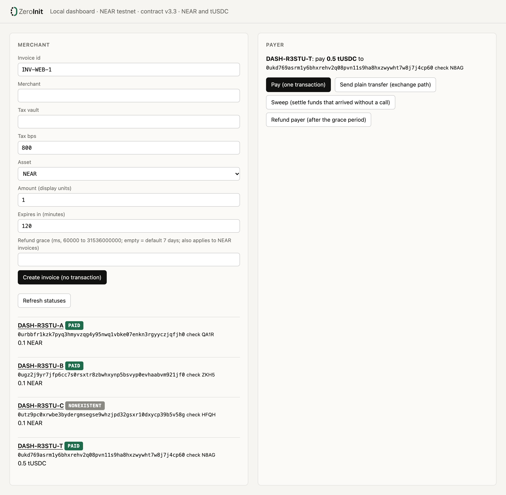

<div align="center">

<picture>
  <source media="(prefers-color-scheme: dark)" srcset="docs/img/logo-dark.png">
  
</picture>

### Invoice addresses that cost nothing until they are paid.

Every invoice gets its own NEAR address, and issuing it needs no transaction.<br>
**[zeroinit.vercel.app](https://zeroinit.vercel.app)** · NEAR **testnet only** · mock token only · MIT

[](https://zeroinit.vercel.app)
[](docs/LIMITS.md)
[](https://github.com/erhantrk/zeroinit/actions/workflows/tests.yml)
[](https://github.com/erhantrk/zeroinit/actions/workflows/verify-contract.yml)
[](LICENSE)

[Try it](#try-it-in-2-minutes) · [Claims](#claims-and-how-to-check-them) · [How it works](docs/HOW-IT-WORKS.md) · [Verify](docs/VERIFY.md) · [Limits](docs/LIMITS.md) · [AI use](AI_USE.md)

</div>

---

ZeroInit gives every invoice its own NEAR address, computed from the invoice terms, so issuing an invoice sends nothing to the chain.
The payer's one transaction creates the account, pays the merchant and sets the tax aside (92/8 in the demo); nobody holds a key to that account.

**Why it is new.** Designs that give each item (an invoice, an NFT, a job) its own NEAR account create that account first: one transaction and one storage deposit per item, paid before anyone has paid anything.
ZeroInit derives the address from the terms with NEAR's deterministic account ids (protocol 88), so **issuing costs 0 transactions**; the account comes into existence only when someone pays.

- **Live site:** <https://zeroinit.vercel.app>
- **The one-transaction payment** on testnet: [`GFzvAw8t…`](https://testnet.nearblocks.io/txns/GFzvAw8t95XhN1JnvSNY4K9sThv7HQahLp9AnJ2SHQLe) (invoice `INV-1111-V33-A`, contract v3.3: state init + `pay`, 0.92 to the merchant, 0.08 to the tax vault)
- **For a bookkeeper:** `zi export` writes one CSV row per invoice: status, amount, merchant and tax shares, payer, payment time and due date, all read from the chain. No keys needed: `npx -y @erhantrk/zeroinit export --dir invoices/v33 --out invoices.csv`
- **For AI agents:** an [MCP server](mcp/README.md) with `issue_invoice`, `invoice_status` and `verify_invoice` (read-only, never signs). No clone needed: `claude mcp add zeroinit -- npx -y -p @erhantrk/zeroinit zeroinit-mcp`

Tracks: **Real-World Money** (primary) · **Open Innovation**. Testnet only, mock token only, not audited.


*The local dashboard (`npm run zi -- serve`), Chrome, 2026-11-13 UTC, contract v3.3. The first NEAR invoice was paid in one transaction, the second by a plain transfer and a sweep, the third was issued and never paid, so its account does not exist; the tUSDC invoice was paid from the page, with its registration on the token in the same transaction as the payment. Each address shows its check code.*

## Try it in 2 minutes

Fastest, with no clone (Node 22 or newer, package [`@erhantrk/zeroinit`](https://www.npmjs.com/package/@erhantrk/zeroinit) 0.2.0 or newer, which ships the v3.3 recordings; `export` needs 0.3.0):

```bash
npx -y @erhantrk/zeroinit verify INV-1111-V33-A              # read-only live check over testnet RPC: every line PASS, ends INFO status=PAID
npx -y @erhantrk/zeroinit replay fixtures/v33/demo-run.json  # the recorded live run, replayed offline: 62 PASS lines, exit 0
```

From a clone, the full check. No keys and no `.env` needed. Node 22; `npm ci` needs the npm registry once, everything after that is offline except the last line.

```bash
npm ci --include=dev
npm test                                             # 263 tests, all pass
npm run zi -- replay fixtures/v33/demo-run.json      # a recorded live testnet run, replayed offline: 62 PASS lines, exit 0
bash scripts/judge-offline.sh                        # the whole offline check; last line: JUDGE-OFFLINE: ALL PASS
npm run zi -- verify INV-1111-V33-A                  # one read-only live check over testnet RPC: every line PASS, ends PASS no-access-keys / INFO status=PAID
```

The replay prints, among 62 `PASS` lines, `PASS pay-tx-success INV-1111-V33-A GFzvAw8t… []`, `PASS split-merchant INV-1111-V33-A 0.92` and `PASS split-vault INV-1111-V33-A 0.08`.
Every step, with its full expected output, is in [docs/VERIFY.md](docs/VERIFY.md).

## Headline numbers

| | |
|---|---|
| **0** | transactions to issue an invoice |
| **1** | transaction to create the invoice account, pay and split the money |
| **0** | access keys on an invoice account (`zi verify` prints `PASS no-access-keys`) |
| **0.0075647 NEAR** | measured cost of that one transaction to the payer (gas plus NEAR's 0.007 NEAR account-creation charge) |
| **263 + 104** | offline JavaScript tests (`npm test`) + Rust unit tests on the contract (`npm run contract:test`) |
| **1** | reproducible build: the deployed code `CrwuvfSL…` is what `cargo near build reproducible-wasm` produces at commit `7727a1c`; CI rebuilds it from the on-chain metadata on every push, and it is verified on [SourceScan](docs/REPRODUCE.md#sourcescan) ([docs/REPRODUCE.md](docs/REPRODUCE.md#one-command-straight-from-the-chain)) |

## What NEAR does here

- **Deterministic account ids (protocol 88, NEP-655).** An account id can be the SHA3-256 hash of its future code and state, so the invoice address is printed before the account exists. The invoice terms are inside the hashed state, so they cannot change after issuing.
- **One transaction does everything.** `[UniversalStateInit, FunctionCall pay]` creates the account, runs the contract and splits the payment.
- **Plain transfers work too.** A plain NEAR transfer from any wallet or exchange waits in the "uninitialized" account, which only the matching state init can unlock; then anyone calls `sweep`. If the payer later pays with `pay` as well, the contract counts what is already parked and charges the price once.
- **Global contract by hash.** The invoice code is published once as a global contract; each invoice only references its hash, and nobody can change what that hash runs.

Details, diagrams and every contract rule: [docs/HOW-IT-WORKS.md](docs/HOW-IT-WORKS.md).

## Claims and how to check them

| Claim | Command | Expected |
|---|---|---|
| Issuing an invoice sends no transaction | `npm run zi -- invoice new --id TEST-1 --merchant example-zi-merchant.testnet --tax-vault example-zi-taxvault.testnet --tax-bps 800 --amount 0.1 --expires-in 2h --offline` | `INVOICE` / `ACCOUNT 0u…` / `PAY` / `FILE` lines, no RPC call |
| One transaction creates the account, pays and splits (NEAR) | `npm run zi -- replay fixtures/v33/demo-run.json` | `PASS pay-tx-success INV-1111-V33-A GFzvAw8t… []`, `PASS split-merchant … 0.92`, `PASS split-vault … 0.08` |
| A plain transfer from a wallet or exchange is safe before the account exists | same replay | `PASS transfer-path-uninitialized INV-1111-V33-B 1`, `PASS sweep-tx-result INV-1111-V33-B 2j8vbU6k… result=PAID` |
| A token invoice (tUSDC, a testnet mock) is paid by a plain `ft_transfer` and swept by anyone | `npm run zi -- replay fixtures/v33/token-demo-run.json` | `PASS plain-transfer-tx-success TOK-1111-V33-A 8Z7Zk7pz… []`, `PASS ft-parked-balance TOK-1111-V33-A 1`, `PASS ft-split-merchant … 0.92`, `PASS ft-split-vault … 0.08` |
| A payment on top of parked funds is charged once | `npm run zi -- replay fixtures/v33/parked.json` | `PASS pay-parked-applied PARK-V33-N …` (NEAR: 0.3 parked, `pay` of 1, 0.3 back) / `PASS ft-parked-applied PARK-V33-T …` (tUSDC: 0.4 parked, 0.6 used, 0.4 back) |
| Nobody holds a key to an invoice account | `npm run zi -- verify INV-1111-V33-A` (read-only RPC) | `PASS no-access-keys` |
| An accountant gets a spreadsheet, with every status read from the chain | `npm run zi -- export --dir invoices/v33 --out invoices.csv` (read-only RPC) | `EXPORT 11 invoice(s) to invoices.csv`; `INV-1111-V33-A,PAID,NEAR,1,0.92,0.08,8,1,2026-11-13T08:48:54.501Z,…` |
| The deployed code is the committed wasm, rebuilt from this source | `shasum -a 256 contract/res/v3.3/zeroinit_invoice.wasm`, then the `verify` above | `b03c1b08…2a8e` (base58 `CrwuvfSL…aVsb`); `PASS code-hash-onchain CrwuvfSL…` |

More claims (the address commits to the terms, the token-sweep race, two token payments at once, the private callback, the check code) and the older versions' claims: [docs/VERIFY.md](docs/VERIFY.md#all-claims).

## Limits

Full list with the evidence: [docs/LIMITS.md](docs/LIMITS.md).

- **Testnet only, mock token only, not audited.** The audit rounds were AI reviews. tUSDC is a testnet mock with no value and no issuer.
- **A token invoice id must be registered on the token before tokens can reach it.** That is a rule of the token standard (NEP-145), not of this contract. Our client sends the registration (`storage_deposit`, 0.00125 NEAR) in the same transaction as the payment. An exchange withdrawal is a plain `ft_transfer` from someone else's software, so someone (the merchant, the payer or anyone) must register the id first. For tokens only issuing is free; "no transaction until paid" holds fully for NEAR invoices.
- **Plain-transfer underpayments and overpayments are not refunded** (`sweep` cannot know the payer).
- **No checksum in the address.** The `0u…` format belongs to NEAR and has none: a mistyped address is a valid address for other bytes, and funds sent there are lost. `zi invoice new` prints a 4-character check code (`CHECK MVNC` for `INV-1111-V33-A`), and `zi check <address> <code>` says PASS or FAIL offline. It only helps a payer who checks; a raw address pasted into a wallet is still unprotected.
- **Wallet support is untested.** The dashboard was opened in Chrome on v3.3 for NEAR and tUSDC invoices (pay, plain transfer, sweep); the `SETTLING`/`REFUNDED` badges and Refund payer were not tried in a browser.
- **Transaction lookups need an archival RPC** after about 1.5 days; state checks and offline replays keep working.

## Not in this build

- **Paying from another chain (NEAR Intents, 1Click).** Intents has no testnet (hackathon rule Q-007) and ZeroInit runs on testnet only, so a payer pays in NEAR or tUSDC on NEAR. An Intents deposit that ends in a plain transfer or `ft_transfer` to the `0u…` address would settle like any plain transfer, but that path was not built or tried.
- **Gasless payment for the payer (meta transactions, a relayer).** The payer pays the gas: 0.0075647 NEAR for the measured NEAR payment. The merchant never needs gas: payouts arrive without a merchant transaction, and anyone can run `sweep`.
- **Line items.** An invoice holds one amount, a tax rate, a due date and an id; line items would live in the merchant's own records next to the invoice id.

## Who holds keys

The invoice contract has no owner and no admin call, and invoice accounts have no keys. The tUSDC mock token (`zeroinit-tusdc.testnet`) and the operator's deployer, merchant, tax-vault, payer and sweeper accounts (`zeroinit-deployer.testnet`, `zeroinit-merchant.testnet` and so on, created for v3.3) each hold one full-access key: a **token invoice trusts whoever controls the token contract**, which on testnet is the operator. The full table and the command to re-check it: [docs/LIMITS.md](docs/LIMITS.md#who-holds-keys).

## Repo map

- `contract/` — the invoice contract (Rust, near-sdk 5.30.1, 104 unit tests). `contract/res/v3.3/zeroinit_invoice.wasm` is the deployed wasm; `contract/res/v3.2r/` and `contract/res/v3.2/` hold earlier builds (history). `contract-v2/` is the v2 contract (history, 14 tests).
- `src/` — the `zi` CLI, the byte encoders (`bytes.ts`, `stateinit.ts`, `tx.ts`), RPC client, outcome parser, invoice documents, offline replay, and the local dashboard server (`server.ts`; the page is in `web/`).
- `cli/` — the npm package `@erhantrk/zeroinit`: the `zi` CLI, the library and the MCP server as bundled files plus the v3.3 recordings, assembled by `npm run build:cli`.
- `mcp/` — the MCP server (`mcp/dist/zeroinit-mcp.mjs` is the bundled single file), shipped in the npm package as the `zeroinit-mcp` command; each GitHub release rebuilds the bundle and checks it is the committed file (`.github/workflows/release.yml`).
- `fixtures/` — recorded live RPC sessions that replay offline: `v33/` (current), `v32r/`, `v32/`, `v31/`, `v3/`, `v2/`, `v1/` (history), plus synthetic fixtures used by tests only.
- `invoices/` — the invoice documents of those runs (`v33/` current), `demo/` (the invoices of the dashboard runs: `DASH-R3STU-*` on v3.3, `DASH-53NMD-*` on v3.2r) and `examples/INV-0001.json` (the frozen test vector). No secrets.
- `scripts/` — `judge-offline.sh`, the demo and recording scripts that produced the fixtures, and small signing helpers.
- `site/` — the landing page (Astro), live at <https://zeroinit.vercel.app>. It shows the v3.3 recording `fixtures/v33/demo-run.json`. Build: `cd site && npm ci && npm run build` (Node >= 22.23.4); the replay data comes from `python3 -I site/scripts/extract-replay.py`.
- `docs/` — [HOW-IT-WORKS](docs/HOW-IT-WORKS.md), [VERIFY](docs/VERIFY.md), [LIMITS](docs/LIMITS.md), [REPRODUCE](docs/REPRODUCE.md), [RUN-ON-TESTNET](docs/RUN-ON-TESTNET.md) (the keyed walkthrough), [ARCHITECTURE](docs/ARCHITECTURE.md) (measured costs, design by version), [STABLECOIN](docs/STABLECOIN.md) (the token interface spec), [HISTORY](docs/HISTORY.md) (v1 to v3.3), [SPIKES](docs/SPIKES.md) (every live transaction). [SPEC.md](SPEC.md) is the v1 interface spec.

## No code from before the hackathon window

Every commit is inside the hackathon window. The first commit (`ea8d0fb`) is the plan with a reference implementation drafted with Claude during the planning phase of this hackathon; the next commits copied it into `src/` and `contract/`, and everything after was built on top. Detail and how to check it: [AI_USE.md](AI_USE.md#code-provenance).

## AI use

The code, tests and docs were written and reviewed with AI models (DeepSeek V4.1 Flash, Claude Sonnet 5.5 and Claude Opus 5.5 built and ran it; Claude Fable 5.2 did the final audit and, with Claude Opus 5.5, built v3.3); a human decided, ran the accounts and is responsible. Who did what, round by round: [AI_USE.md](AI_USE.md).

## Also by the same author: ProvenExit

**ProvenExit** is a separate submission to the same hackathon: <https://github.com/erhantrk/provenexit> (public), site <https://provenexit.vercel.app>. The two projects share no code.

## License

MIT, see [LICENSE](LICENSE). The mock token source is [test-usdc](https://github.com/erhantrk/test-usdc) (public, MIT); the deployed mock `zeroinit-tusdc.testnet` is built from its commit `94396e4`.
