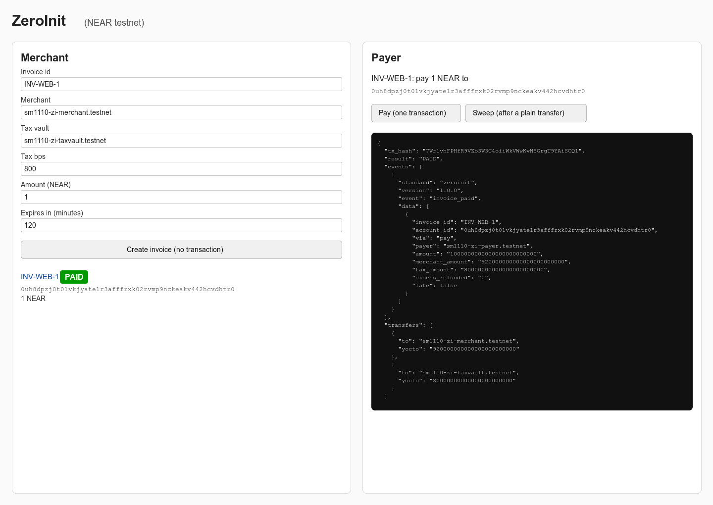

# Run ZeroInit yourself on testnet

Moved out of the README to keep it short. Everything here signs real testnet transactions with **your** accounts and keys (testnet NEAR only; nothing here was run by the audit-fix round).
Offline checks that need no keys are in the README ("Try it offline in 2 minutes").

## Run it yourself on testnet

This walkthrough was recorded on **v3** (`fixtures/v3/`, NEAR then tUSDC); the same commands run on the current **v3.2r** deployment,
whose re-recorded runs are in `fixtures/v32/` (v3.1: `fixtures/v31/`). The recorded runs in `fixtures/v3/` were made with the project's own CLI and the operator's
accounts, exactly the commands below; the account-creation commands in step 1 are the near-cli-rs form the operator used for the earlier accounts and are not part of the
recorded v3 runs.

Testnet only: `src/config.ts` refuses any other network and any RPC URL containing `mainnet`, and every command asserts `chain_id == testnet` over RPC. You need Node 22.22.x; account
creation uses near-cli-rs. The steps below assume you are in the repo root.

1. Pick a prefix that is still free on testnet; `example` stands for it below. Create four accounts (the legacy
   keychain stores their keys under `~/.near-credentials/testnet/`):

   ```bash
   export P=example
   for a in deployer merchant taxvault payer; do
     near account create-account sponsor-by-faucet-service "$P"-zi-$a.testnet \
       autogenerate-new-keypair save-to-legacy-keychain network-config testnet create
   done
   ```

   Each command prints the new account and a transaction hash. The payer needs a little NEAR; the faucet grant
   is enough for this walkthrough, top up at https://near-faucet.io/ if it is not.

2. No deploy needed: `contract/res/v3.2r/zeroinit_invoice.wasm` is already a global contract on testnet with code hash `BQLSk5carin64UMreToJHT15gvow6wqZSyKqDz7zCFry` (v3.2r, the reproducible build of commit `4116e69`).
   Optionally deploy your own copy (this burns about 16.4 NEAR, about the cost of the v3.2 deploy; the hash of an identical wasm is the same, so only a
   changed wasm gives a new hash):

   ```bash
   near contract deploy-as-global use-file contract/res/v3.2r/zeroinit_invoice.wasm \
     as-global-hash "$P"-zi-deployer.testnet network-config testnet sign-with-legacy-keychain send
   ```

3. `cp .env.example .env` and fill it in (uncomment the account and key lines). `.env.example` prefills the v3.2r hash and the FastNEAR RPC; change the hash only if you
   deployed your own changed global contract in step 2. Set `ZI_PAYER_ACCOUNT=example-zi-payer.testnet`, `ZI_SWEEPER_ACCOUNT=example-zi-merchant.testnet`,
   `ZI_TAXVAULT_ACCOUNT=example-zi-taxvault.testnet`, and for `ZI_PAYER_KEY` / `ZI_SWEEPER_KEY` paste the
   `private_key` values from `~/.near-credentials/testnet/example-zi-payer.testnet.json` and
   `~/.near-credentials/testnet/example-zi-merchant.testnet.json`. `.env` is gitignored: never commit it.
   Load it in every shell with `set -a; source .env; set +a`.

4. Issue an invoice. It needs no key and the address is computed locally; by default it makes two read-only RPC calls
   (network check, and that the merchant and tax vault accounts exist). Add `--offline` to skip them:

   ```bash
   npm run zi -- invoice new --id INV-RUN-1 --merchant example-zi-merchant.testnet \
     --tax-vault example-zi-taxvault.testnet --tax-bps 800 --amount 0.1 --expires-in 2h
   npm run zi -- status INV-RUN-1
   ```

   ```
   INVOICE INV-RUN-1
   ACCOUNT 0u…                                  (54 characters, derived from the terms and the code hash)
   PAY 0.1 NEAR before 2026-…
   FILE invoices/INV-RUN-1.json
   STATE NONEXISTENT
   ```

5. Pay it in one transaction (signs with `ZI_PAYER_KEY`; the expected shape is from our recorded run, the tx hash
   and account id are yours):

   ```bash
   npm run zi -- pay INV-RUN-1
   ```

   ```
   TX …
   RESULT PAID
   EVENT invoice_paid {"invoice_id":"INV-RUN-1", … "merchant_amount":"92000000000000000000000","tax_amount":"8000000000000000000000", …}
   TRANSFER example-zi-merchant.testnet 0.092
   TRANSFER example-zi-taxvault.testnet 0.008
   LINK https://testnet.nearblocks.io/txns/…
   STATE INITIALIZED status=PAID paid_by=example-zi-payer.testnet balance=0 storage=…
   ```

6. Verify it, then try the wallet path and a refund:

   ```bash
   npm run zi -- verify INV-RUN-1
   # PASS code-hash-trusted / INFO deployment v3.2r (current… / PASS format-matches-deployment / PASS id-from-terms 0u… / PASS raw-from-terms / PASS doc-fields-from-terms / PASS code-hash-onchain 6YtW5oJ8… / PASS terms-onchain /
   # PASS no-access-keys / INFO status=PAID

   npm run zi -- invoice new --id INV-RUN-2 --merchant example-zi-merchant.testnet \
     --tax-vault example-zi-taxvault.testnet --tax-bps 800 --amount 0.1 --expires-in 2h
   ACC=$(node -e "console.log(require('./invoices/INV-RUN-2.json').account_id)")
   node scripts/plain-transfer.ts "$ACC" 0.1      # a bare Transfer, exactly what a wallet or exchange sends
   npm run zi -- status INV-RUN-2                 # STATE UNINITIALIZED balance=0.1
   npm run zi -- sweep INV-RUN-2                  # RESULT PAID; anyone can send the sweep

   npm run zi -- invoice new --id INV-RUN-3 --merchant example-zi-merchant.testnet \
     --tax-vault example-zi-taxvault.testnet --tax-bps 800 --amount 0.1 --expires-in 2h
   npm run zi -- pay INV-RUN-3 --amount 0.05      # RESULT REFUNDED_UNDERPAID, 0.05 goes back to the payer
   ```

   On a real TTY, `near tokens example-zi-payer.testnet send-near "$ACC" '0.1 NEAR' network-config testnet
   sign-with-legacy-keychain send` sends the same plain transfer. In our headless runs near-cli-rs printed
   `does not exist on testnet` and then needed an interactive confirmation, so the scripts use
   `scripts/plain-transfer.ts` (same single `Transfer` action, signed with the payer key).

7. tUSDC (a **testnet mock** token; its owner mints it, so ask for some, or run your own copy of the `test-usdc` token and set `ZI_TUSDC_ACCOUNT`). The merchant and tax vault
   must be registered on the token (NEP-145), the payer must hold tUSDC. The commands are the ones recorded in `fixtures/v3/tokens.json` and `fixtures/v3/failures.json`:

   ```bash
   npm run zi -- token register example-zi-merchant.testnet      # once per account; the payer key pays the 0.00125 NEAR storage deposit
   npm run zi -- token register example-zi-taxvault.testnet
   npm run zi -- invoice new --id TOK-RUN-1 --merchant example-zi-merchant.testnet --tax-vault example-zi-taxvault.testnet \
     --tax-bps 800 --amount 1 --expires-in 2h --token tUSDC     # checks the allow-list, ft_metadata and the registrations
   npm run zi -- pay TOK-RUN-1 --plain       # exchange path: registers the id, sends a bare ft_transfer; STATE NONEXISTENT tokens_parked=1 tUSDC
   npm run zi -- sweep TOK-RUN-1             # anyone: [UniversalStateInit, fund, sweep] in one tx; 0.92 / 0.08 tUSDC, invoice_paid from on_settled
   npm run zi -- invoice new --id TOK-RUN-2 … --token tUSDC
   npm run zi -- pay TOK-RUN-2               # one-step path: register id, init + fund, then ft_transfer_call; exit 0 only on invoice_paid
   ```

   **Registration is a transaction.** A token invoice id must be registered on the token (`storage_deposit`, 0.00125 NEAR, one transaction by the merchant, the payer or anyone) *before* any
   `ft_transfer` to it can succeed; `zi pay` does it for you, an exchange withdrawal does not. **Do not mix paths:** if a plain `ft_transfer` already parked tokens on the invoice, run `zi sweep`;
   `zi pay` (and the dashboard) refuse then, because a one-step payment on top of parked tokens is charged twice (`--allow-parked` overrides on the CLI).

   If a receiver is not registered, its payout fails, the share stays owed (`SETTLING`, `transfer_failed`), and after `zi token register <account>` a `zi sweep` delivers
   it (recorded as `UNREG-V3`); `zi refund-payer <id>` returns undelivered shares to the payer after the invoice's grace period (recorded as `TOK-V3-G`).

8. Optional local dashboard:

   ```bash
   npm run zi -- serve --port 8787
   # SERVE http://127.0.0.1:8787
   # OPEN http://127.0.0.1:8787/#zi_token=<random per run>
   ```

   Open the **OPEN** url (the token after `#` is never sent to the server; every `POST` must carry it in `x-zi-token`, so another local
   process that only knows the port cannot make the server sign; a bare `http://127.0.0.1:8787/` shows the list but its buttons get 403).
   The page is served with a Content-Security-Policy (no inline script) and escapes every invoice-file value; invoice files are untrusted
   input. A document that is not the invoice its own terms derive (or whose account runs other code/terms) shows an **UNVERIFIED** badge,
   and `zi status` exits 1 with `STATE UNVERIFIED`. Create an invoice (no transaction), pay, or send a plain transfer and sweep. The server signs with
   the payer/sweeper keys from `.env` and binds `127.0.0.1` only. Statuses load when the page opens, after each
   action, and when you click **Refresh statuses** (no polling, to stay under public RPC rate limits).

   

   *This screenshot is from the **v2** dashboard. The v3.2 dashboard (token selector, `SETTLING`/`REFUNDED` badges, Refund payer) has not been opened in a browser; its invoice file `INV-SHOT-1.json` is not in the repo (`invoices/` root is gitignored), so `zi status INV-SHOT-1` cannot be run from a clone.*
